# Kinex Mark – felhasználói kézikönyv

A Kinex Mark a Kinexium linkgyűjteménye: webes alkalmazás, amelyben a hasznos linkeket rögzíted, színes címkékkel csoportosítod, és használat szerint rangsorolod. A kézikönyv a felhasználóknak, az adminisztrátoroknak és az üzemeltetőknek szól. A felületi feliratokat szó szerint, „idézőjelben” idézi a magyar felületről.

A képek a magyar felületet mutatják sötét témában, kitalált demóadatokkal (Tóth Eszter adminisztrátor, Kovács Anna és Nagy Bence fejlesztő, Szabó Péter ügyfél). Valódi személyes adat a képeken nincs. A képek a demóadatok különböző pillanataiban készültek, ezért a linkek és a címkék száma képenként eltér (például a 3.1 szakasz képén már látszanak az 5.10 szakaszban importált címkék), és a demóadatok egyszerre rögzített használatai miatt sok sor utolsó használata azonos.

## Tartalom

1. [Bevezetés](#1-bevezetés)
2. [Belépés](#2-belépés)
3. [A felület](#3-a-felület)
4. [Linkek rögzítése](#4-linkek-rögzítése)
5. [Linkek használata](#5-linkek-használata)
6. [Archiválás](#6-archiválás)
7. [Címkék](#7-címkék)
8. [Megosztás](#8-megosztás)
9. [Beállítások](#9-beállítások)
10. [Adatvédelem](#10-adatvédelem)
11. [Adminisztráció](#11-adminisztráció)
12. [Hibaelhárítás és gyakori kérdések](#12-hibaelhárítás-és-gyakori-kérdések)
- [A függelék: szerepkörök és jogosultságok](#a-függelék-szerepkörök-és-jogosultságok)
- [B függelék: üzemeltetés](#b-függelék-üzemeltetés)
- [C függelék: ismert korlátok](#c-függelék-ismert-korlátok)

---

## 1. Bevezetés

### 1.1 Mire való

A Kinex Mark a munkához használt linkek gyűjteménye. Amit tud:

- **Gyors rögzítés:** a linket ráhúzod az ablakra, beilleszted a vágólapról, vagy kézzel felveszed. A link azonnal mentődik, a címét és az ikonját a szerver a háttérben tölti le.
- **Leírás és színes címkék:** minden linkhez rövid leírást írhatsz, és több címkét tehetsz rá. A csoportosítás kizárólag címkékkel történik, mappák nincsenek.
- **Lista- és csempenézet**, szűrés szöveggel és címkékkel, a megjelenített adatok (ikon, URL, cím, leírás) ki- és bekapcsolása.
- **Rangsor használat szerint:** a gyakran megnyitott vagy másolt linkek előre kerülnek. A kitűzött linkek mindig elöl állnak, köztük is a használat dönt.
- **Automatikus archiválás:** amit a beállított ideig (alapból 90 napig) nem nyitottál meg és nem másoltál, az archívumba kerül, és csak külön kapcsolóval látszik.
- **Gyors másolás:** URL-ként vagy Markdown-linkként (`[felirat](URL)`).
- **Megosztás:** a fejlesztők és az adminisztrátorok mindenkivel, egy szerepkörrel vagy egy felhasználóval megoszthatják a saját linkjeiket.
- **Biztonság:** a felület csak bejelentkezés után érhető el, a kétlépcsős azonosítás bekapcsolható, minden felhasználó csak a saját és a vele megosztott linkeket látja.
- **Nyelv és téma:** magyar, angol vagy német felület, sötét vagy világos téma.

### 1.2 Szerepkörök röviden

| Szerepkör | Mit tehet |
|---|---|
| Ügyfél | Saját linkeket és címkéket kezel, látja a vele megosztott linkeket. Linket nem oszthat meg. |
| Fejlesztő | Mint az ügyfél, és a saját linkjeit megoszthatja. |
| Adminisztrátor | Mint a fejlesztő, és kezeli a felhasználókat, a rendszerbeállításokat és az audit naplót. Más felhasználó linkjeit ő sem látja. |

A részletes táblázat az [A függelékben](#a-függelék-szerepkörök-és-jogosultságok) van. A felület néhány szövege (például a bejelentkező oldalon és a tájékoztatóban) „rendszergazdát” említ: ez az adminisztrátor. A kézikönyvben az üzemeltető a szervert telepítő és működtető személy vagy szervezet (B függelék).

### 1.3 Böngésző

- Használj egy friss asztali vagy mobil böngészőt (Chrome, Edge, Firefox vagy Safari aktuális verzióját) bekapcsolt JavaScripttel. Az automatikus felületi tesztek Chromiumon futnak, asztali és mobil méretben.
- A felület 390 px széles telefontól a nagy asztali kijelzőig használható.
- A vágólapra másolás biztonságos kapcsolatot (HTTPS vagy `localhost`) igényel. Sima HTTP-n a böngésző tilthatja, lásd a [12.8 szakaszt](#128-a-másolás-nem-működik).
- Fiókot egy adminisztrátor hoz létre. Nyilvános regisztráció nincs.

---

## 2. Belépés

### 2.1 Bejelentkezés

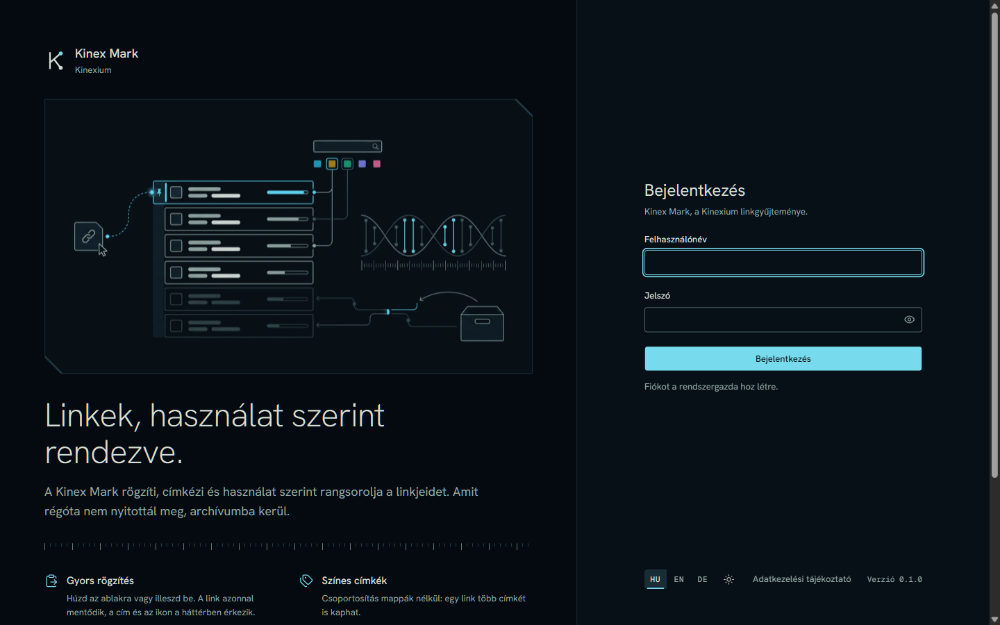

1. Nyisd meg a Kinex Mark címét a böngészőben. Bejelentkezés nélkül minden oldal ide irányít, kivéve az adatkezelési tájékoztatót.
2. Töltsd ki a „Felhasználónév” és a „Jelszó” mezőt. A szem ikonnal („Jelszó megjelenítése”) a beírt jelszót ellenőrizheted.
3. Kattints a „Bejelentkezés” gombra.

Ha a fiókodon be van kapcsolva a kétlépcsős azonosítás, a következő lépés a kód megadása (2.2). Ha a fiókod ideiglenes jelszóval készült, a rendszer előbb új jelszót kér (2.3).

Lehetséges üzenetek:

| Üzenet | Jelentése és teendő |
|---|---|
| „Hibás felhasználónév vagy jelszó.” | Ellenőrizd a beírt adatokat. Az üzenet nem árulja el, hogy a felhasználónév létezik-e. |
| „A fiók inaktív.” | Egy adminisztrátor inaktiválta a fiókot. Fordulj hozzá. |
| „Túl sok sikertelen próbálkozás.” | Öt hibás próbálkozás 15 percen belül 15 percre zárolja a fiókot, minden újabb zárolás kétszer olyan hosszú (legfeljebb 24 óra). A gomb a zárolás végéig tiltott, a hátralévő perceket az üzenet mutatja. Ugyanarról az IP-címről 30 hibás próbálkozás is 15 perces zárolást ad. Az adminisztrátor a zárolást feloldhatja (11.1). |
| „A munkamenet lejárt.” | Tétlenség vagy a leghosszabb munkamenet-idő miatt lejárt a bejelentkezés. Jelentkezz be újra. |
| „A fiókod törlődött.” | A fiókodat törölték, vagy te törölted. |

A bejelentkezés tétlenség után (alapból 720 perc) vagy a leghosszabb időtartam (alapból 168 óra) elteltével lejár. Az értékeket az adminisztrátor állítja (11.2).

### 2.2 Kétlépcsős azonosítás belépéskor

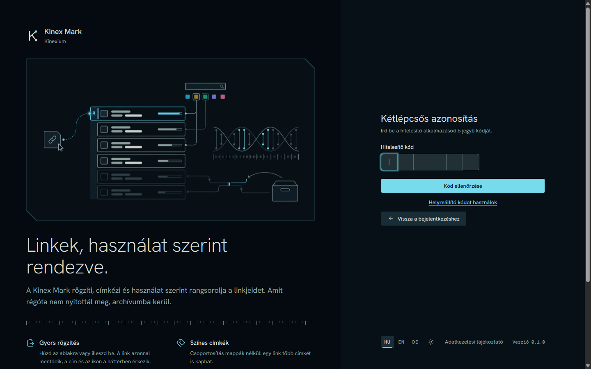

1. Nyisd meg a hitelesítő alkalmazásodat (például Google Authenticator, Microsoft Authenticator, Aegis vagy 1Password), és keresd meg a Kinex Mark bejegyzést.
2. Írd be a hatjegyű kódot a „Hitelesítő kód” mezőbe. A hatodik számjegy után a kód magától elküldődik, de a „Kód ellenőrzése” gombbal is beküldheted.

Ha a telefonod nincs kéznél:

1. Kattints a „Helyreállító kódot használok” linkre.
2. Írd be az egyik elmentett helyreállító kódodat (`xxxxx-xxxxx` alakú). A kötőjel és a szóköz elhagyható.
3. Belépés után értesítés mutatja, hány kódod maradt. Ha 3 vagy kevesebb, generálj újakat (9.3).

A „Hitelesítő kódot használok” link visz vissza a kódmezőhöz, a „Vissza a bejelentkezéshez” az első lépéshez. A második lépés 5 percig érvényes, és legfeljebb ötször próbálkozhatsz. Utána „A belépési kérés lejárt.” üzenet jelenik meg: kezdd újra a jelszóval. Az elgépelt kódok ugyanúgy számítanak a zárolásba, mint a hibás jelszó.

### 2.3 Első belépés: kötelező jelszócsere

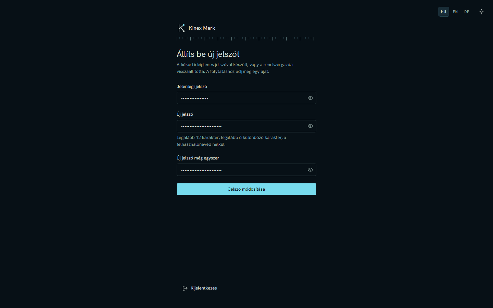

Ha a fiókod ideiglenes jelszóval készült, vagy egy adminisztrátor visszaállította a jelszavadat, a belépés után az „Állíts be új jelszót” oldal jelenik meg. Amíg nem cserélsz jelszót, más oldalt nem érsz el.

1. A „Jelenlegi jelszó” mezőbe írd az ideiglenes jelszót.
2. Az „Új jelszó” és az „Új jelszó még egyszer” mezőbe írd az új jelszót. A szabály: „Legalább 12 karakter, legalább 6 különböző karakter, a felhasználóneved nélkül.” Legfeljebb 128 karakter lehet, és nem egyezhet a jelenlegivel. Szám vagy írásjel nem kötelező, egy hosszú jelmondat jó választás.
3. Kattints a „Jelszó módosítása” gombra.

### 2.4 Első belépés: az adatkezelési tájékoztató nyugtázása


Az első belépéskor, és minden alkalommal, amikor egy adminisztrátor a tájékoztató új verzióját kiadja, a rendszer kéri, hogy nyugtázd: megismerted, hogyan kezeli a Kinex Mark az adataidat.

1. Olvasd el a tájékoztatót a dobozban, vagy nyisd meg új lapon a „Megnyitás teljes oldalon” linkkel.
2. Pipáld be az „Elolvastam az adatkezelési tájékoztatót, és tudomásul veszem.” jelölőnégyzetet.
3. Kattints a „Tudomásul vettem, tovább” gombra.

A nyugtázás a megismerés rögzítése, nem hozzájárulás. Ha közben új verzió jelent meg, a „Közben új tájékoztató jelent meg.” üzenet után olvasd el és nyugtázd az újat.

### 2.5 Nyelv és téma belépés előtt

A bejelentkező oldal alján és a kapuoldalak (jelszócsere, tájékoztató) jobb felső sarkában:

- **HU, EN, DE:** a felület nyelve. A belépés előtt választott nyelv a belépés után is megmarad, és a fiókod beállításaiba is mentődik.
- **Nap vagy hold ikon („Téma váltása”):** sötét és világos téma között vált. Belépés előtt ez csak ebben a böngészőben érvényes.

Csak a bejelentkező oldalon:

- **„Adatkezelési tájékoztató”:** a tájékoztató bejelentkezés nélkül is olvasható.
- A **„Verzió …”** felirat a futó program verzióját mutatja, hibabejelentéskor add meg.

### 2.6 Kijelentkezés

1. Kattints az oldalsáv alján a nevedre (felhasználói menü).
2. Válaszd a „Kijelentkezés” pontot.

A jelszócsere- és a tájékoztató-oldalon a „Kijelentkezés” gomb az oldal alján van. Kijelentkezés után a bejelentkező oldal „Kijelentkeztél.” üzenetet mutat. Ha más eszközön is be vagy jelentkezve, azokat a Beállítások › Biztonság fülön zárhatod le (9.4).

---

## 3. A felület

### 3.1 Oldalsáv, felső sáv, tartalom


**Oldalsáv** (bal oldalon):

- „Gyűjtemény”: „Linkek” (a nem archivált linkjeid száma) és „Címkék” (a címkéid száma).
- „Gyakori címkék”: az a nyolc címke, amelyen a legtöbb nem archivált link van. Egy címkére kattintva a lista csak az ő linkjeit mutatja (7.5).
- „Fiók”: „Beállítások”.
- „Adminisztráció”: „Felhasználók”, „Rendszerbeállítások”, „Audit napló”. Csak adminisztrátor látja.
- Alul a felhasználói menü a neveddel és a szerepköröddel: „Beállítások”, „Adatkezelési tájékoztató”, „Kijelentkezés”.

**Felső sáv:**

- Morzsamenü, például „Gyűjtemény › Linkek” vagy „Beállítások › Profil”.
- Keresőmező („Keresés…”). A Linkek oldalon gépelés közben szűr, más oldalon az Enter a Linkek oldalra visz a kereséssel.
- Földgömb ikon („Nyelv”): Magyar, English, Deutsch.
- Nap vagy hold ikon („Téma váltása”).

A billentyűzettel dolgozóknak az oldal első eleme az „Ugrás a tartalomra” link.

### 3.2 Keresés

1. Kattints a keresőmezőbe, vagy nyomd meg a `/` billentyűt.
2. Gépeld be a keresett szövegrészletet. A keresés a címben, a leírásban, az URL-ben és a link saját címkéinek nevében keres, a kis- és nagybetű és az ékezet nem számít (az „arviz” megtalálja az „Árvíz” szót).
3. Az `Esc` először törli a beírt szöveget, mobilon a második `Esc` bezárja a keresőt.

A szűrés részletei az [5.3 szakaszban](#53-szűrés-szöveggel-és-címkével) vannak.

### 3.3 Nyelv

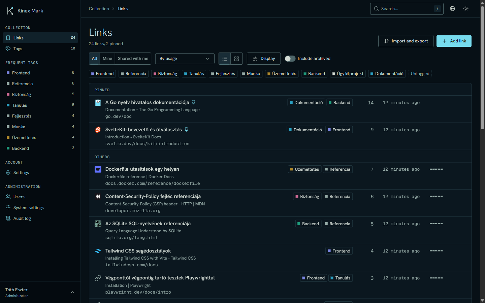

1. Kattints a felső sáv földgömb ikonjára.
2. Válaszd a „Magyar”, „English” vagy „Deutsch” pontot.

A választás a fiókodhoz mentődik, és minden eszközödön érvényes. Ugyanez a Beállítások › Megjelenítés fülön is állítható (9.5). A nyelv a felület szövegeit, a dátum- és számformátumot és a billentyűnevek feliratát változtatja meg (német felületen például `Strg` és `Entf`). A linkek címe, leírása és a címkék neve a beírt szöveg marad.

### 3.4 Téma

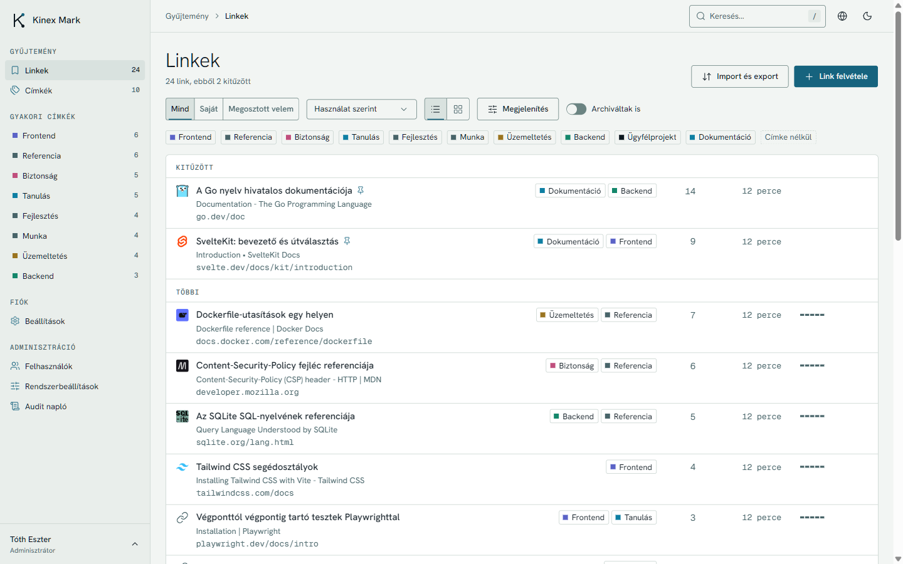

- A felső sáv nap vagy hold ikonja („Téma váltása”) a sötét és a világos téma között vált.
- A Beállítások › Megjelenítés fülön a „Sötét”, „Világos” és „Rendszer szerint” lehetőség közül választhatsz. A „Rendszer szerint” az operációs rendszer beállítását követi.
- Bejelentkezve a téma a fiókodhoz mentődik. Az alapértelmezés a sötét téma.

### 3.5 Mobil nézet

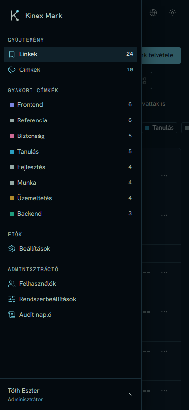

768 px szélesség alatt:

- Az oldalsáv rejtett. A felső sáv bal szélén lévő gombbal („Oldalsáv megnyitása”) nyisd meg.
- A keresőmező helyén ikon van („Keresés megnyitása”), amely teljes szélességű keresőt nyit.
- A címkesor vízszintesen görgethető, a sorok műveletei a `⋯` menüben érhetők el. Érintőképernyőn a sorgombok mindig láthatók.
- Telefonon a csempenézet egyoszlopos, és 640 px alatt a részletek lap teljes szélességű.

### 3.6 Billentyűparancsok

A parancsok szövegmezőben és nyitott dialógusnál nem működnek. A táblázatot a `?` billentyűvel vagy a „Megjelenítés” menü „Billentyűparancsok” pontjával is megnyithatod. A `/` és a `?` minden oldalon működik, a többi a Linkek oldalon.

| Billentyű | Hatás |
|---|---|
| `/` | Fókusz a keresőmezőre |
| `N` | Link felvétele |
| `Ctrl` `V` (macOS-en `⌘` `V`) | Gyors rögzítés a vágólapról (minden bejelentkezett oldalon) |
| `J` vagy `↓` | Következő link |
| `K` vagy `↑` | Előző link |
| `Enter` | A kijelölt link megnyitása |
| `P` | Kitűzés váltása |
| `C` | URL másolása |
| `M` | Másolás Markdownként |
| `I` | Részletek |
| `E` | Szerkesztés (csak saját linknél) |
| `A` | Archiválás vagy visszaállítás |
| `Delete` | Törlés megerősítéssel (csak saját linknél) |
| `V` | Lista és csempe váltása |
| `?` | Billentyűparancsok |
| `Esc` | Keresés törlése a keresőmezőben |

A `J` és a `K` akkor is működik, ha előtte a tartalom egy üres részére kattintottál. Billentyűvel archivált link után a kijelölés a következő sorra lép.

---

## 4. Linkek rögzítése

A link mindig azonnal mentődik. A címét és az ikonját a szerver a háttérben tölti le, ez néhány másodperc. Ugyanazt az URL-t egy felhasználó csak egyszer veheti fel.

### 4.1 Felvétel dialógussal

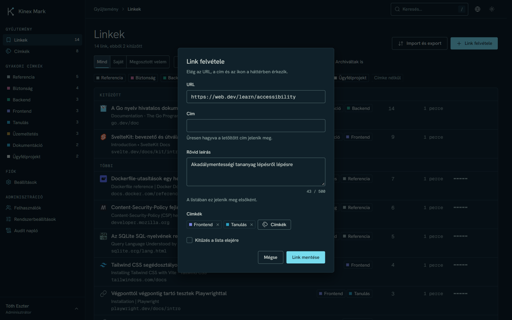

1. Kattints a Linkek oldalon a „Link felvétele” gombra, vagy nyomd meg az `N` billentyűt.
2. Az „URL” mezőbe írd a teljes címet, például `https://example.com/docs`. Csak `http` és `https` cím menthető, felhasználónév és jelszó nem lehet benne, a hossza legfeljebb 2048 bájt.
3. A „Cím” mezőt hagyd üresen, ha a webhely saját címét szeretnéd: „Üresen hagyva a letöltött cím jelenik meg.” Ha kitöltöd, a te címed marad meg, a letöltés nem írja felül.
4. A „Rövid leírás” mezőbe írj legfeljebb 500 karaktert. „A listában ez jelenik meg elsőként.”
5. A „Címkék” gombbal válassz címkéket (legfeljebb 20). Ha a keresett címke még nincs meg, a választó felajánlja: „»név« címke létrehozása”.
6. Ha a linket rögtön a lista elejére szeretnéd, pipáld be a „Kitűzés a lista elejére” jelölőnégyzetet.
7. Kattints a „Link mentése” gombra. Az értesítés: „Link mentve”.

Ha az URL már megvan a gyűjteményedben, „Ez a link már megvan a gyűjteményedben.” figyelmeztetés jelenik meg. A „Megjelenítés a listában” gomb a meglévő linkhez visz, és kiemeli.

### 4.2 Ráhúzás

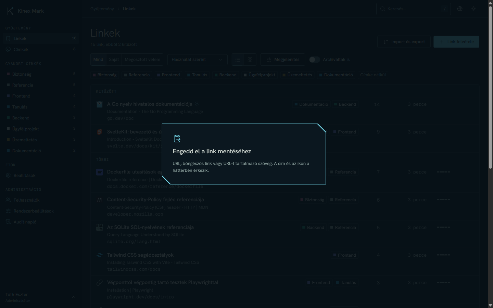

1. Fogd meg a linket egy másik böngészőlapon (a címsorból, egy oldal linkjét vagy kijelölt szöveget, amelyben URL van).
2. Húzd a Kinex Mark ablakára. Megjelenik az „Engedd el a link mentéséhez” panel.
3. Engedd el. A link mentődik, az értesítés „Link mentve”, mellette „Szerkesztés” gomb a leírás és a címkék megadásához.

Tudnivalók:

- Ha a ráhúzott linknek látható szövege volt, az lesz a címe.
- Több link egyszerre is ráhúzható, egyszerre legfeljebb 20. A többiről értesítés szól: „Egyszerre legfeljebb 20 link menthető, a többi kimaradt.” Több link után összesítő értesítés jelenik meg: „{n} link mentve, {m} már megvolt”.
- Ha a link már megvolt: „Ez a link már megvan”, mellette „Megjelenítés”.
- Ha a mentett linket a jelenlegi szűrők elrejtik: „Link mentve. A jelenlegi szűrők elrejtik.”, mellette „Szűrők törlése”.
- A Kinex Mark saját sorainak húzása nem indít rögzítést, fájlt pedig nem fogad el.
- Nyitott dialógus mellett a ráhúzás nem rögzít.

### 4.3 Beillesztés a vágólapról

1. Másold ki a linket, vagy egy URL-t tartalmazó szöveget.
2. A Kinex Mark bármelyik oldalán, szövegmezőn kívül nyomd meg a `Ctrl` `V` (macOS-en `⌘` `V`) billentyűt.

A program a szöveg első `http://` vagy `https://` kezdetű címét menti. Ha ilyen nincs, de a szöveg domainnel kezdődik (például `example.com/docs`), `https://` előtaggal menti. Ha egyik sincs: „Nem található URL.” Ha nem a Linkek oldalon vagy, az értesítés „Megnyitás” gombja odavisz, és kiemeli az új linket. Szövegmezőben a beillesztés a szokásos módon működik, nem rögzít.

### 4.4 A cím és az ikon letöltése

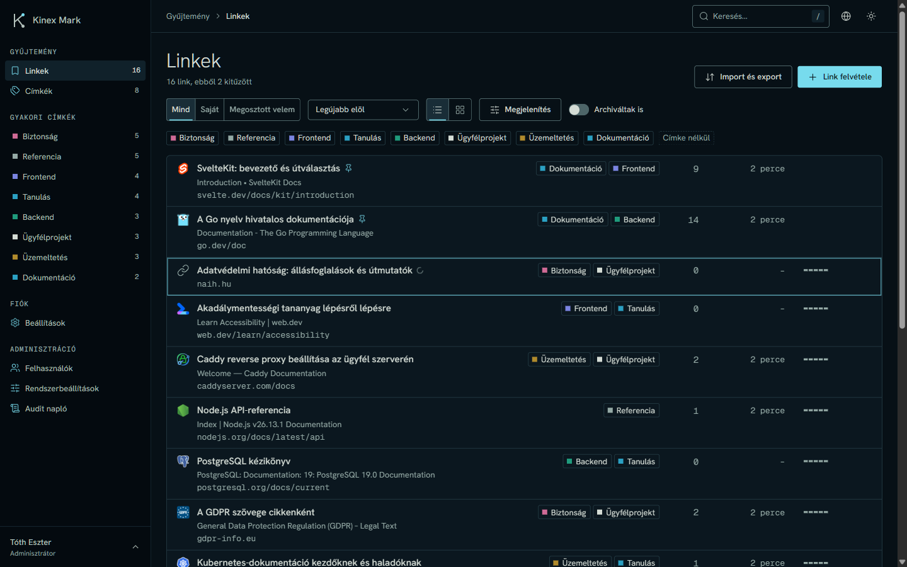

- Amíg a letöltés tart, a link mellett forgó jel látszik, a súgója: „Cím és ikon letöltése folyamatban”. Amíg a cím nem érkezik meg, a felirat a leírás, ha nincs leírás, az URL (hosszú URL-nél csak a domain).
- A cím a weboldal `<title>` eleméből jön (ha az üres, az `og:title` metaadatból). Az ikon a weboldal által megadott ikon, ennek hiányában a `/favicon.ico`. Ha nincs használható ikon, általános link ikon jelenik meg.
- A letöltést a szerver végzi, nem a böngésződ. A böngésződ így csak akkor kapcsolódik a webhelyhez, amikor megnyitod a linket.
- Átmeneti hibánál (időtúllépés, névfeloldás, kapcsolódási hiba, 5xx vagy 429 válasz) a szerver 1 perc, majd 10 perc múlva újrapróbálja, a harmadik hiba után a letöltés sikertelen.
- A letöltés eredményét a részletek lap „Metaadat” szakasza mutatja (5.8). Az állapotok: „Letöltés folyamatban”, „Letöltve”, „Sikertelen”, „Tiltott hálózati cím”, mellettük a hiba oka (például „Időtúllépés”, „A domain nem található”, „Tanúsítványhiba”, „Nem weboldal (nincs cím)”).

Szabályok a címre:

- A kézzel beírt címet a letöltés soha nem írja felül.
- Ha a szerkesztéskor törlöd a kézi címet, a program újra letölti a webhely címét.
- Ha a link URL-jét módosítod, a régi letöltött cím és ikon törlődik, és a program az új címről tölti le őket. A kézi cím megmarad.

### 4.5 Kézi frissítés

Ha a webhely címe vagy ikonja megváltozott, vagy a letöltés sikertelen volt:

1. Nyisd meg a saját linked `⋯` menüjét, vagy a részletek lapot.
2. Válaszd a „Cím és ikon frissítése” pontot. Az értesítés: „A cím és az ikon frissítése elindult”.

A frissítés a letöltött címet és az ikont felülírja, a kézi címet nem. Csak a link tulajdonosa frissíthet.

### 4.6 Duplikáció

Egy felhasználónál egy URL csak egyszer szerepelhet. Az összehasonlítás előtt a program egységesíti a címet: a séma és a domain kisbetűs lesz, az alapértelmezett port (`:80`, `:443`) elmarad, üres útvonal helyett `/` áll. A query és a fragment (`?…`, `#…`) változatlan, ezért az eltérő paraméterű címek külön linkek.

| Rögzítés módja | Ha az URL már megvan |
|---|---|
| Dialógus | „Ez a link már megvan a gyűjteményedben.” és „Megjelenítés a listában” |
| Ráhúzás, beillesztés | „Ez a link már megvan” és „Megjelenítés”; a meglévő sor kiemelődik |
| Importálás | a bejegyzés kimarad, az eredményben „Már megvolt” |

Egy felhasználó legfeljebb 10 000 linket tárolhat („Elérted a 10 000 linkes korlátot.”).

---

## 5. Linkek használata

### 5.1 Lista- és csempenézet


- Az eszközsor két ikongombja vált a „Lista” és a „Csempe” nézet között, billentyűvel a `V`.
- A választás a fiókodhoz mentődik. Az alapnézetet a Beállítások › Megjelenítés fülön állíthatod (9.5).

A lista egy sora (lásd a 3.1 szakasz képét):

- Ikon és a link **felirata**. A felirat a leírás, ha nincs, a cím, végül az URL. Hosszú URL helyett csak a domain látszik.
- A felirat alatt a többi adat: a cím, a leírás és a rövidített URL, ha nem egyezik a felirattal.
- Jelölők: tű ikon a kitűzött linken, két alak ikon a veled megosztott linken (súgó: „Megosztotta: {név}”), „Archivált” jelvény az archivált linken, forgó jel a letöltés alatt.
- Címkék: a szélességtől függően 1–3 címke, a többi „+n” jelölőben.
- Széles képernyőn a használatszám (súgó: „{n} használat (megnyitás vagy másolás)”), az utolsó használat ideje, és az archiválásig hátralévő idő jelzője (6.2).
- Jobb szélen a kitűzés gombja és a `⋯` menü („Műveletek: …”). Egérrel ezek a sor fölé állva látszanak.

A csempén ugyanezek az adatok vannak, a felirat legfeljebb két sorban. A csempe egésze nem kattintható, a linket a feliratra kattintva nyitod meg.

### 5.2 Megjelenített adatok

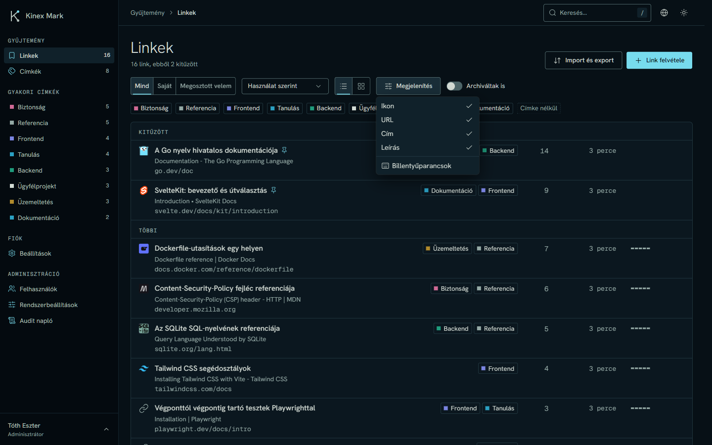

1. Kattints az eszközsor „Megjelenítés” gombjára.
2. Kapcsold ki vagy be az „Ikon”, „URL”, „Cím” és „Leírás” pontot. A hatás azonnali, és a választás a fiókodhoz mentődik.

A felirat a bekapcsolt mezőkből készül: a leírás, ennek hiányában a cím, végül az URL. Kikapcsolt mezőt a felirat sem használ. Ha a leírást és a címet is kikapcsolod, a felirat az URL lesz. A Markdown-másolás és a törlés megerősítése mindig a teljes sorrendet használja (leírás, cím, URL), a kapcsolóktól függetlenül.

### 5.3 Szűrés szöveggel és címkével

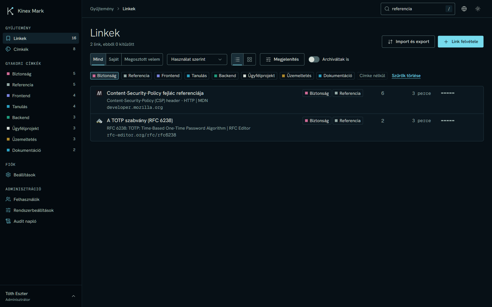

**Szöveg:** írj a felső sáv keresőmezőjébe (3.2). A lista gépelés közben szűkül. A keresés részletre is talál: a „referencia” szó a leírásban, a címben, az URL-ben és a link saját címkéinek nevében is számít.

**Címke:**

1. Kattints egy címkére az eszközsor alatti címkesorban. A kiválasztott címke kiemelve látszik.
2. Több címkét is kiválaszthatsz. Két kiválasztott címkétől megjelenik a „Bármelyik / Mind” választó: „Bármelyik” esetén elég egy címke egyezése, „Mind” esetén mindegyiknek rajta kell lennie a linken.
3. A „Címke nélkül” a címke nélküli linkeket mutatja.
4. Ha 12-nél több címkéd van, a többit a „További címkék (n)” gomb mutatja, kereséssel („Címke keresése…”).

**Hatókör:** a „Mind / Saját / Megosztott velem” választó a saját vagy a veled megosztott linkekre szűkít.

**Szűrők törlése:** a „Szűrők törlése” link a keresést, a címkéket, a „Címke nélkül” szűrőt és a hatókört egyszerre alaphelyzetbe állítja. Ha egy szűrésre nincs találat: „Nincs találat.” – „Módosítsd a keresést, vagy töröld a szűrőket.”

Az oldal fejléce a szűrt halmazt számolja: „{n} link, ebből {k} kitűzött”. A szűrők a böngésző címsorában is megjelennek, így a szűrt nézet könyvjelzőként elmenthető.

### 5.4 Rendezés és használat

A rendezés választója az eszközsorban van:

| Rendezés | Sorrend |
|---|---|
| „Használat szerint” (alapértelmezett) | előbb a kitűzött linkek, köztük is a több használat; azonos számnál a frissebb használat; a soha nem használt linkek a csoport végén; végül a legújabb elöl |
| „Legújabb elöl” | előbb a kitűzött linkek, utána a rögzítés ideje szerint |
| „Név szerint” | előbb a kitűzött linkek, utána a felirat (leírás, cím vagy domain) ábécérendben, a kis- és nagybetűtől és az ékezettől függetlenül (az „Árvíz” az a betűs feliratok között áll) |

„Használat szerint” rendezésnél a lista két csoportban jelenik meg: „Kitűzött” és „Többi”.

**Mi számít használatnak:**

- a link **megnyitása**: kattintás a feliratra, középső egérgombos kattintás, `Enter` a kijelölt linken, a „Megnyitás” menüpont vagy a részletek lap „Megnyitás” gombja; egy megnyitás egy használat;
- a link **másolása**: „URL másolása”, „Másolás Markdownként”, a `C` és az `M` billentyű, és a részletek lap URL melletti másoló gombja.

Nem számít használatnak a részletek megtekintése, a szerkesztés, a címkék módosítása és a jobb egérgombos helyi menüből indított megnyitás. A használatszám személyes: a veled megosztott linknél a te megnyitásaidat számolja, nem a tulajdonosét.

### 5.5 Kitűzés

- Kattints a sor tű ikonjára („Kitűzés”), vagy válaszd a `⋯` menü „Kitűzés” pontját, vagy nyomd meg a `P` billentyűt. Értesítés: „Link kitűzve”.
- Ugyanígy szünteted meg: „Kitűzés megszüntetése”, értesítés: „Kitűzés megszüntetve”.
- A kitűzött link minden rendezésnél elöl áll, és soha nem archiválódik automatikusan.
- Archivált link kitűzése vissza is állítja: „Link kitűzve és visszaállítva”.
- A kitűzés személyes: a veled megosztott linket is kitűzheted, ez csak a te listádat érinti.

### 5.6 Megnyitás

Kattints a link feliratára. A link új lapon nyílik, a megnyitott oldal nem kapja meg, honnan érkeztél. A megnyitás használatnak számít, és az archivált linket visszaállítja.

### 5.7 Másolás URL-ként és Markdownként

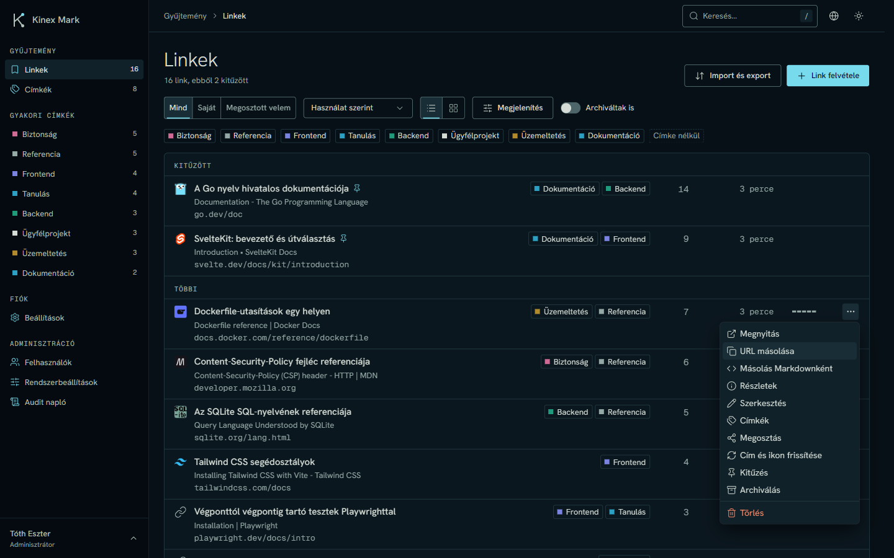

1. Nyisd meg a sor `⋯` menüjét.
2. Válaszd az „URL másolása” pontot (értesítés: „URL másolva”), vagy a „Másolás Markdownként” pontot (értesítés: „Markdown-link másolva”).

Billentyűvel: jelöld ki a linket (`J`, `K`), majd nyomd meg a `C` vagy az `M` billentyűt.

A Markdown alak `[felirat](URL)`, például `[Dockerfile-utasítások egy helyen](https://docs.docker.com/reference/dockerfile/)`. A feliratban a `[`, `]` és `\` karakter elé `\` kerül, az URL-ben a szóköz és a zárójel kódolva van, így a link Markdownban is működik. A másolás használatnak számít, mert a beillesztett link ugyanúgy használat, mint a megnyitás.

Ha a másolás nem sikerül, „A másolás nem sikerült. Jelöld ki és másold kézzel.” üzenet jelenik meg (12.8).

### 5.8 Részletek


Nyisd meg a sor `⋯` menüjének „Részletek” pontját, vagy jelöld ki a linket, és nyomd meg az `I` billentyűt. A „Link részletei” lap minden információt mutat:

- **Fejléc:** ikon, felirat, domain; gombok: „Megnyitás”, „URL másolása”, „Másolás Markdownként”, kitűzés.
- **„Adatok”:** a teljes URL (olvasható alakban, ékezetekkel) másoló gombbal, „Cím”, „Leírás”, „Címkék” („Címkék szerkesztése” linkkel), megosztott linknél a „Tulajdonos”.
- **„Használat”:** „Használat” (a megnyitások és másolások száma, alatta az utolsó használat ideje vagy „Még nem használtad”), „Archiválás” (a várható archiválás napja és „{n} nap múlva” vagy „ma esedékes”; archivált linknél az archiválás napja és „Már archiválva”; „Soha” kitűzött linknél vagy kikapcsolt archiválásnál), „Rögzítve”.
- **„Időpontok”:** „Rögzítve”, „Módosítva”, „Utolsó használat”, „Megosztva veled” (megosztott linknél), „Tétlen ettől”, „Archiválva” (dátum és ok: „automatikusan” vagy „kézzel”).
- **„Metaadat”:** a letöltés állapota és hibája, a „Letöltés ideje”, a „Próbálkozások” száma; tulajdonosnak „Cím és ikon frissítése”.
- **„Megosztás”:** a tulajdonos fejlesztőnek és adminisztrátornak a jelenlegi megosztások és a „Megosztás kezelése” gomb.
- **Lap alja:** „Szerkesztés” (tulajdonos), „Archiválás” vagy „Visszaállítás”, „Link törlése” (tulajdonos).

### 5.9 Szerkesztés és törlés

**Szerkesztés** (csak saját link): `⋯` menü › „Szerkesztés” vagy az `E` billentyű. A „Link szerkesztése” dialógusban az URL, a cím, a rövid leírás és a címkék módosíthatók. „A módosítás mindenkinél látszik, akivel a linket megosztottad.” Mentés: „Link mentése”.

**Címkék** (minden látható linken, a megosztottakon is): `⋯` menü › „Címkék”. A „Címkék szerkesztése” dialógusban válaszd ki a címkéket, majd kattints a „Címkék mentése” gombra.

**Törlés** (csak saját link):

1. `⋯` menü › „Törlés”, vagy a `Delete` billentyű.
2. A „Törlöd ezt a linket?” kérdésre kattints a „Link törlése” gombra.

A törlés végleges: a link megosztásai és minden felhasználó használati adatai is törlődnek. A veled megosztott linket nem törölheted. Ha nem akarod látni, archiváld (6.4).

### 5.10 Importálás és exportálás

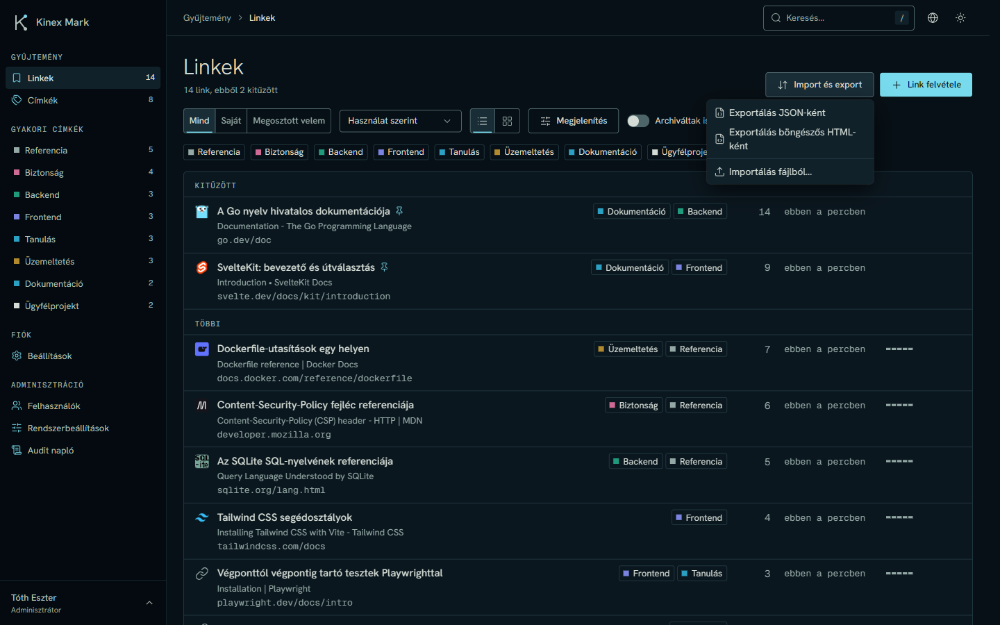

**Exportálás:**

1. Kattints a Linkek oldal „Import és export” gombjára.
2. Válaszd az „Exportálás JSON-ként” vagy az „Exportálás böngészős HTML-ként” pontot. A letöltött fájl neve `kinex-mark-links-ÉÉÉÉHHNN.json` vagy `.html`.

Az export csak a **saját** linkjeidet tartalmazza, a címük, leírásuk, címkéik nevével és a rögzítés idejével. A kitűzés, a használati adatok és a címkeszínek nem kerülnek bele. A HTML-fájl a böngészők könyvjelző-importjával is beolvasható.

**Importálás:**

1. Kattints az „Import és export” gombra, majd az „Importálás fájlból…” pontra.
2. Válassz egy Kinex Mark JSON-exportot (`.json`) vagy egy böngészőből exportált HTML-könyvjelzőfájlt (`.html`, `.htm`).
3. Az „Importálás kész” dialógus mutatja az eredményt: „Összesen”, „Új”, „Már megvolt”, „Hibás”. Kattints a „Bezárás” gombra.

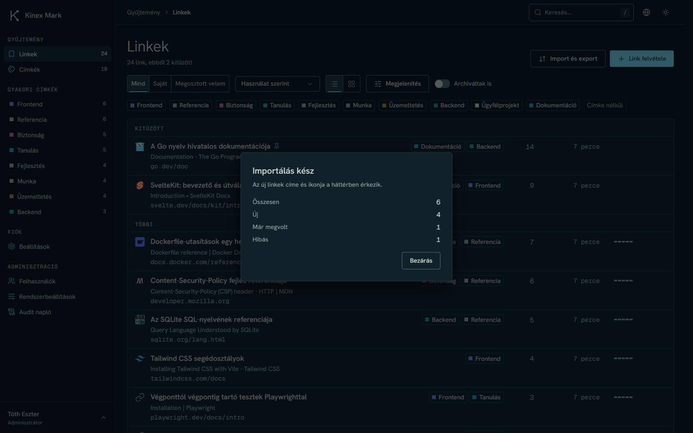

Szabályok:

- A fájl legfeljebb 2 MB és 5000 bejegyzés lehet. 2 MB fölött: „A fájl nagyobb 2 MB-nál.”; 5000-nél több bejegyzésnél: „A fájlban 5000-nél több bejegyzés van.” Mindkét esetben bontsd a fájlt több részre.
- A már meglévő URL-ek kimaradnak („Már megvolt”), az érvénytelen URL-ek is („Hibás”).
- A böngészős fájlban a link legközelebbi mappájának neve címkévé válik (a mappaszerkezet nem marad meg), a fájl címkéi (`TAGS`) is átjönnek. Egy bejegyzés legfeljebb 20 címkét kap.
- A böngésző gyökérmappái (például „Könyvjelzősáv”) is címkévé válnak; ezeket importálás után átnevezheted vagy törölheted (7.3, 7.4).
- A hiányzó címkék „Semleges” színnel jönnek létre, a meglévőkhöz a program név szerint köt. Ha eléred az 500 címkés korlátot, a további új címkék kimaradnak, a linkek létrejönnek.
- A bejegyzés címe, ha van, kézi címnek számít: a letöltés nem írja felül, csak az ikont tölti le. A cím és az ikon letöltése a háttérben, fokozatosan történik.
- A rögzítés ideje a fájlban szereplő dátum. Az archiválási idő viszont az import pillanatától számít, így a régi könyvjelzők nem kerülnek rögtön archívumba (6.1).
- Ha az import átlépné a 10 000 linkes korlátot, egyetlen link sem jön létre.
- Ha a fájl nem értelmezhető: „A fájl nem értelmezhető.” – „Kinex Mark JSON-exportot vagy böngészős HTML-könyvjelzőfájlt válassz.”

---

## 6. Archiválás

### 6.1 Az automatikus archiválás szabálya

**Az a link archiválódik automatikusan, amelyet a beállított időszakon belül nem nyitottál meg és nem másoltál, és amely nincs kitűzve.** Az archiválás személyes: csak a te listádat érinti.

Részletesen:

- **Időszak:** a saját beállításod (Beállítások › Megjelenítés › „Automatikus archiválás”), ha megadtad, különben a rendszer-alapérték, amelyet az adminisztrátor állít (alapból 90 nap). A „Soha” beállítás kikapcsolja az automatikus archiválást.
- **Mi számít használatnak:** a megnyitás és a másolás (5.4). A részletek megtekintése, a szerkesztés és a címkézés nem.
- **Mi indítja újra a számlálást:** használat, kitűzés, a kitűzés megszüntetése és a visszaállítás.
- **Honnan számít:**
  - saját link: a rögzítés idejétől, illetve az utolsó használattól;
  - **importált link:** az import idejétől (nem a könyvjelző eredeti dátumától);
  - **megosztott link:** attól, hogy veled megosztották, de legkorábban a fiókod létrehozásától, illetve attól, hogy a link számodra láthatóvá vált (például szerepkör-változás után). A tulajdonos használata nálad nem számít.
- **Kitűzött link** soha nem archiválódik automatikusan.
- **Mikor fut:** a szerver indulásakor, utána óránként. Az archiválás ezért a megjelölt nap körül, legfeljebb egy órával később történik. Az adminisztrátor azonnal is lefuttathatja (11.2).
- Inaktív fiók linkjei nem archiválódnak.

### 6.2 Az elévülés jelzője

A sor jobb szélén öt kis szakasz mutatja, mennyi idő van hátra az archiválásig: minél kevesebb a kitöltött szakasz, annál közelebb van. 7 vagy kevesebb nap előtt homokóra ikon és a napok száma látszik (az utolsó napon „ma”). A súgó: „Archiválás {dátum} körül, ha addig nem nyitod meg és nem másolod”. A jelző nem látszik kitűzött és archivált linken, és akkor sem, ha az archiválás ki van kapcsolva. A pontos dátumot a részletek lap „Archiválás” mezője mutatja.

### 6.3 Archivált linkek megjelenítése

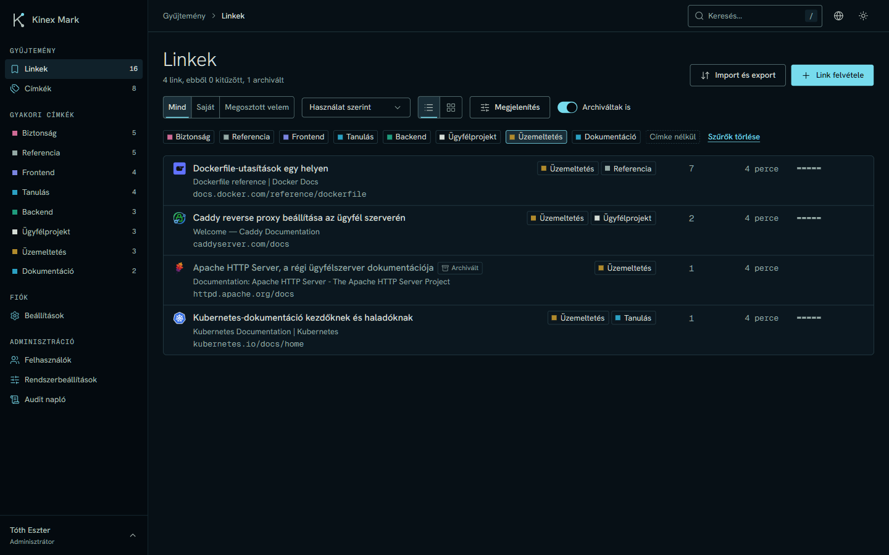

- Alapból az archivált linkek nem látszanak a listában, és a számlálók sem tartalmazzák őket.
- Kapcsold be az eszközsor „Archiváltak is” kapcsolóját. Az archivált linkek „Archivált” jelvénnyel, halványabb felirattal jelennek meg, a fejléc „… {n} archivált” résszel bővül.
- Ha mindig látni szeretnéd őket, a Beállítások › Megjelenítés fülön kapcsold be az „Archiváltak megjelenítése” kapcsolót.
- A szűrők és a keresés az archivált linkekre is érvényesek.

### 6.4 Visszaállítás és kézi archiválás

Az archivált linket a következők bármelyike visszaállítja:

- **megnyitás** vagy **másolás** (ez egyben használat is);
- **kitűzés** („Link kitűzve és visszaállítva”);
- a `⋯` menü vagy a részletek lap **„Visszaállítás”** pontja, vagy az `A` billentyű („Link visszaállítva”).

Kézi archiválás: `⋯` menü › „Archiválás” vagy az `A` billentyű. Az értesítés „Link archiválva”, mellette „Visszavonás” gomb, amellyel azonnal visszahozhatod. A kézi archiválás a kitűzést is megszünteti. A veled megosztott linket is archiválhatod, ez csak a te listádból tünteti el.

### 6.5 Saját archiválási idő

1. Nyisd meg a Beállítások › Megjelenítés fület.
2. Az „Automatikus archiválás” kártyán az „Archiválás tétlenség után” választóban válassz:
   - „Rendszer-alapérték ({n} nap)”: az adminisztrátor beállítását követi;
   - 30, 60, 90, 180 vagy 365 nap;
   - „Soha”: nálad nincs automatikus archiválás;
   - „Egyéni…”: a „Napok száma” mezőbe írj 1 és 3650 közötti számot, majd nyomd meg az Entert, vagy lépj ki a mezőből.
3. A kártya alja mutatja az érvényes értéket, például „Jelenleg: 90 nap tétlenség után.”

---

## 7. Címkék

A címkék személyesek: csak te látod őket, a veled megosztott linkeken is a saját címkéidet használod. Egy linkre legfeljebb 20 címke tehető, egy felhasználónak legfeljebb 500 címkéje lehet.

### 7.1 A Címkék oldal

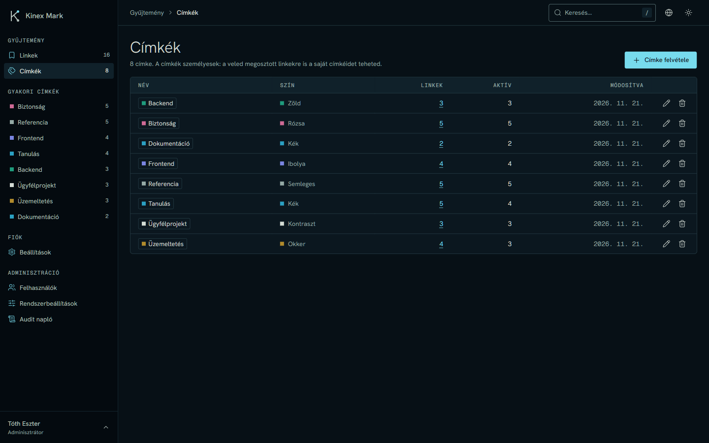

Nyisd meg az oldalsáv „Címkék” pontját. A táblázat oszlopai:

- „Név” és „Szín”;
- „Linkek”: hány látható linkeden van a címke (az archiváltakkal együtt). A számra kattintva a Linkek oldal ezeket a linkeket mutatja, az archiváltakkal együtt;
- „Aktív”: ebből hány nem archivált;
- „Módosítva”;
- szerkesztés (ceruza) és törlés (kuka) ikon.

### 7.2 Létrehozás

1. Kattints a „Címke felvétele” gombra.
2. Írd be a nevét (legfeljebb 40 karakter). Két címkének nem lehet azonos a neve („Ilyen nevű címke már van.”).
3. Válassz színt, és kattints a „Címke mentése” gombra.

Címkét link felvételekor vagy szerkesztésekor is létrehozhatsz: a címkeválasztóba írd be az új nevet, és válaszd a „»név« címke létrehozása” pontot. Az így létrehozott címke színe „Semleges”, ezt később módosíthatod.

### 7.3 Színek és átnevezés

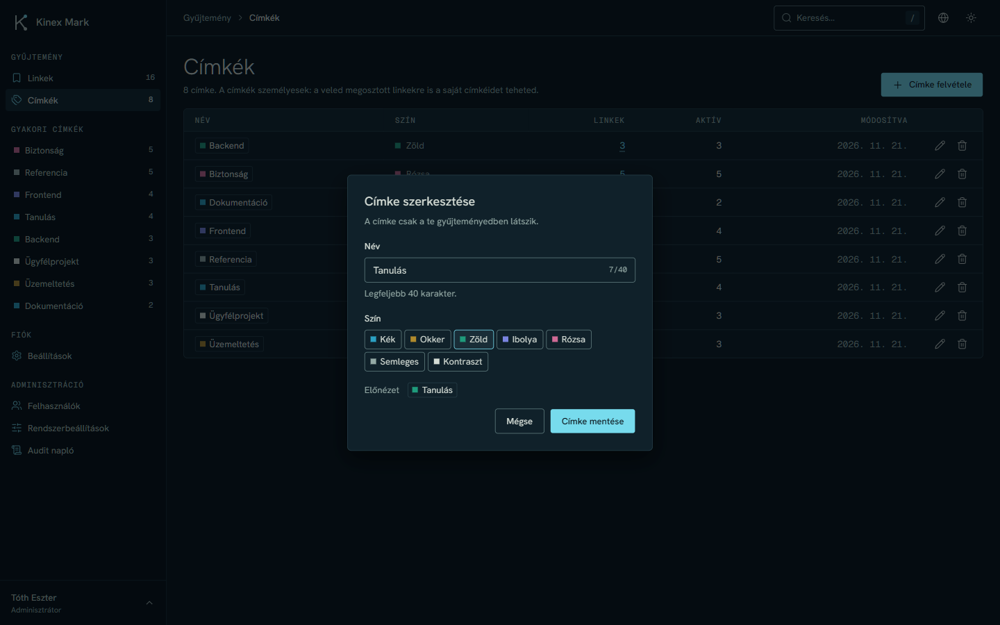

1. Kattints a címke sorában a ceruza ikonra („Szerkesztés: {név}”).
2. A „Címke szerkesztése” dialógusban módosítsd a nevet, vagy válassz másik színt a hét közül: „Kék”, „Okker”, „Zöld”, „Ibolya”, „Rózsa”, „Semleges”, „Kontraszt”. Az „Előnézet” mutatja az eredményt.
3. Kattints a „Címke mentése” gombra.

Az átnevezés és az átszínezés minden linkeden azonnal látszik. A címke mellett mindig a neve is látszik, így a szín soha nem az egyetlen jel.

### 7.4 Törlés

1. Kattints a címke sorában a kuka ikonra („Törlés: {név}”).
2. A „Törlöd ezt a címkét?” kérdésre kattints a „Címke törlése” gombra.

A címke lekerül a linkekről, a linkek megmaradnak.

### 7.5 Csoportosítás címkével

A Kinex Markban nincs mappa: egy csoport egy címke linkjei. Egy link több címkével több csoportban is szerepel. Egy csoportot így nyitsz meg:

- az oldalsáv „Gyakori címkék” csoportjában a címke nevére kattintva;
- a Címkék oldalon a címke „Linkek” számára kattintva;
- a Linkek oldal címkesorában a címkére kattintva.

A csoporton kívüli linkeket a címkesor „Címke nélkül” eleme mutatja.

### 7.6 Címkék a megosztott linkeken

A veled megosztott linkre is teheted a saját címkéidet (`⋯` menü › „Címkék”). Ezeket csak te látod, a tulajdonos és a többi címzett nem. A tulajdonos címkéi nálad nem jelennek meg.

---

## 8. Megosztás

Megosztani csak fejlesztő és adminisztrátor tud, és csak a saját linkjét. Az ügyfél menüjében a „Megosztás” pont nem jelenik meg.

### 8.1 Link megosztása

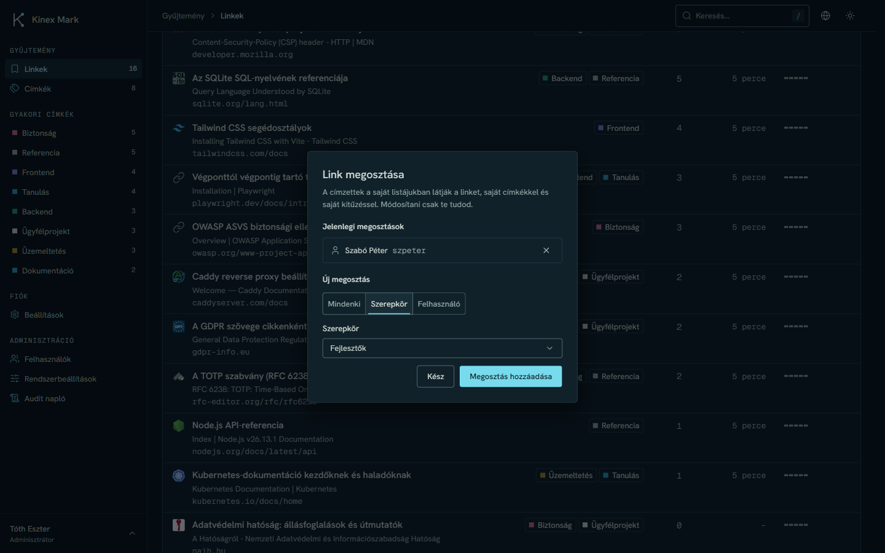

1. Nyisd meg a saját linked `⋯` menüjét, és válaszd a „Megosztás” pontot. A részletek lapon a „Megosztás kezelése” gomb ugyanide visz.
2. Az „Új megosztás” részen válaszd ki a címzett típusát:
   - **„Mindenki”**: minden felhasználó látja;
   - **„Szerepkör”**: a „Szerepkör” választóban válaszd az „Adminisztrátorok”, a „Fejlesztők” vagy az „Ügyfelek” csoportot;
   - **„Felhasználó”**: a „Felhasználó” választóban keresd meg a felhasználót a felhasználóneve vagy a neve alapján („Felhasználó keresése…”). Csak aktív felhasználók jelennek meg.
3. Kattints a „Megosztás hozzáadása” gombra. Értesítés: „Link megosztva”.
4. Kattints a „Kész” gombra.

Ugyanazzal a címzettel kétszer nem oszthatsz meg („Ezzel a címzettel már meg van osztva.”). A megosztás a biztonsági naplóba kerül.

**Visszavonás:** a „Jelenlegi megosztások” listában kattints a címzett melletti `×` ikonra („Megosztás visszavonása: …”). Értesítés: „Megosztás visszavonva”.

### 8.2 A megosztott link a címzettnél

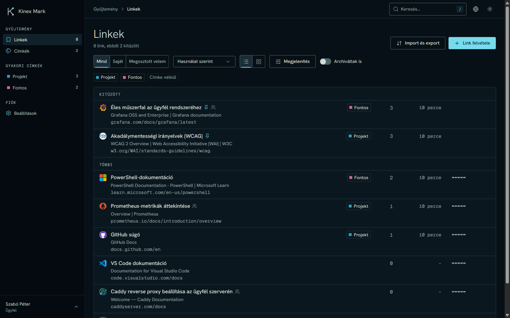

- A címzett a linket a saját listájában látja, két alak ikonnal, a súgóban: „Megosztotta: {név}”. A „Megosztott velem” hatókör csak ezeket mutatja.
- A címzett a saját címkéit teheti rá, kitűzheti, archiválhatja, megnyithatja és másolhatja. Ezek csak nála hatnak.
- A link adatait (URL, cím, leírás) csak a tulajdonos módosíthatja, és a módosítás minden címzettnél látszik. A címzett nem törölheti és nem oszthatja tovább.
- A címzett látja a tulajdonos felhasználónevét és megjelenített nevét.

### 8.3 Mikor szűnik meg a láthatóság

| Esemény | Hatás a címzetteknél |
|---|---|
| A tulajdonos visszavonja a megosztást | a link eltűnik |
| A tulajdonos törli a linket | a link mindenkinél törlődik |
| A tulajdonost az adminisztrátor ügyfél szerepkörre állítja | a megosztásai szünetelnek, a link nem látszik; ha újra fejlesztő vagy adminisztrátor lesz, újra látszik, az archiválási idő ettől a pillanattól számít |
| A tulajdonos fiókját inaktiválják | a megosztásai érvényben maradnak |
| A tulajdonos fiókja törlődik | a linkjei és megosztásai megszűnnek |
| A címzett szerepköre változik | a szerepkörnek szóló megosztások az új szerepkör szerint látszanak |

---

## 9. Beállítások

A beállításokat az oldalsáv „Beállítások” pontjával vagy a felhasználói menüből éred el. Négy füle van: „Profil”, „Biztonság”, „Megjelenítés”, „Adatvédelem”.

### 9.1 Profil

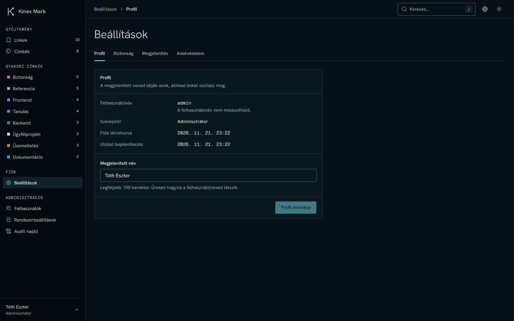

- A „Felhasználónév” nem módosítható.
- A „Megjelenített név” legfeljebb 100 karakter. Üresen hagyva a felhasználóneved látszik. Ezt látják azok, akikkel linket osztasz meg.
- Mentés: „Profil mentése”, értesítés: „Profil mentve”.
- A „Szerepkör”, a „Fiók létrehozva” és az „Utolsó bejelentkezés” csak tájékoztató adat.

### 9.2 Jelszó

1. Nyisd meg a Beállítások › Biztonság fület.
2. A „Jelszó” kártyán töltsd ki a „Jelenlegi jelszó”, az „Új jelszó” és az „Új jelszó még egyszer” mezőt (szabály: 2.3).
3. Kattints a „Jelszó módosítása” gombra. Értesítés: „Jelszó módosítva. A többi eszközön kijelentkeztél.”

### 9.3 Kétlépcsős azonosítás és helyreállító kódok

Bekapcsolt kétlépcsős azonosításnál belépéskor a jelszó mellett a hitelesítő alkalmazás hatjegyű kódja is kell. A bekapcsolás erősen ajánlott, adminisztrátornak különösen.

**Bekapcsolás:**

1. Nyisd meg a Beállítások › Biztonság fület, és a „Kétlépcsős azonosítás” kártyán kattints a „Bekapcsolás” gombra.
2. **1 / 3 lépés:** írd be a jelenlegi jelszavadat, majd kattints a „Jelszó megerősítése” gombra.
3. **2 / 3 lépés – „Olvasd be a QR-kódot”:** a hitelesítő alkalmazással olvasd be a QR-kódot. Ha nem tudod beolvasni, a „Kézi beíráshoz:” alatti titkos kulcsot írd be az alkalmazásba (a másoló ikon: „Titkos kulcs másolása”). Utána írd be az alkalmazásban megjelenő hatjegyű kódot, és kattints a „Kód ellenőrzése” gombra. A beállítás 10 percig érvényes („A beállítás érvényes eddig: …”), utána kezdd újra.

   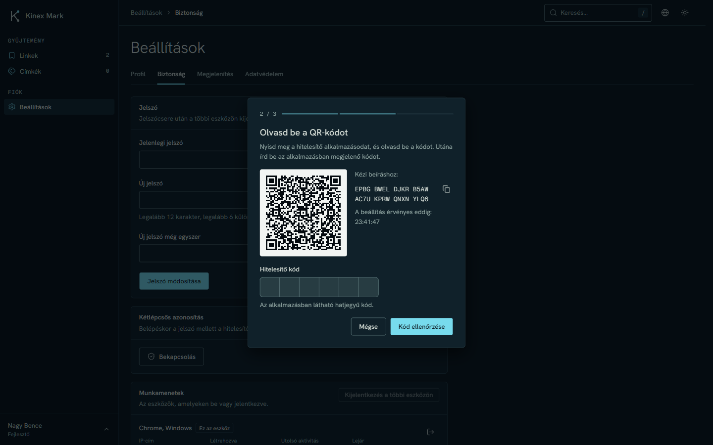

4. **3 / 3 lépés – „Mentsd el a helyreállító kódokat”:** a program 10 helyreállító kódot mutat. Mentsd el őket a „Kódok másolása”, a „Letöltés .txt-ként” vagy a „Nyomtatás” gombbal, és tárold biztonságos helyen, a telefonodtól külön. Pipáld be az „Elmentettem a kódokat, és tudom, hogy csak most láthatók.” jelölőnégyzetet, majd kattints a „Kész” gombra. Értesítés: „Kétlépcsős azonosítás bekapcsolva”.

   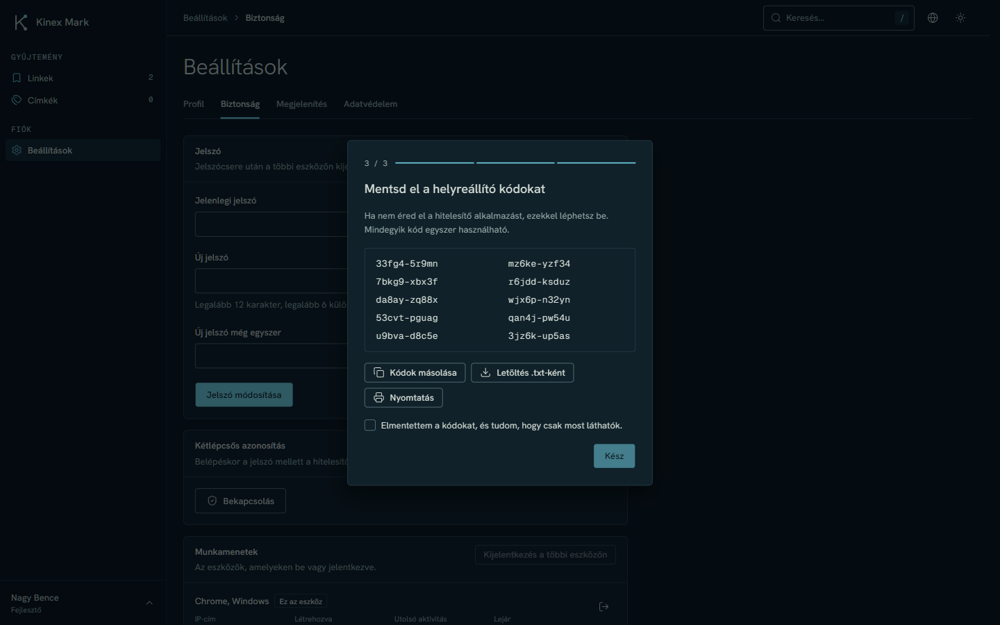

A bekapcsolás után a többi eszközödön kijelentkezel.

A képen látható titkos kulcs és kódok egy kitalált, eldobott demófiókhoz tartoznak. A saját kulcsodat és kódjaidat soha ne oszd meg, és ne készíts róluk megosztott képernyőképet.

**Helyreállító kódok:**

- Mindegyik kód egyszer használható, a hitelesítő kód helyett (2.2).
- A kártya mutatja a „Fel nem használt helyreállító kód” számát. 3 vagy kevesebb kódnál figyelmeztetés jelenik meg: „Kevés helyreállító kódod maradt”.
- **Új kódok:** kattints az „Új helyreállító kódok” gombra, add meg a jelszavadat és egy hitelesítő kódot az alkalmazásból, majd kattints az „Új kódok létrehozása” gombra. A régi kódok érvényüket vesztik, az újak csak egyszer láthatók.

**Kikapcsolás:**

1. Kattints a „Kikapcsolás” gombra.
2. Add meg a jelszavadat, és egy hitelesítő kódot vagy egy fel nem használt helyreállító kódot.
3. Kattints a „Kétlépcsős azonosítás kikapcsolása” gombra.

A kikapcsolás törli a helyreállító kódokat, és a többi eszközödön kijelentkezel.

### 9.4 Munkamenetek


A Beállítások › Biztonság fül „Munkamenetek” kártyája azokat az eszközöket mutatja, amelyeken be vagy jelentkezve: böngésző és rendszer, „IP-cím”, „Létrehozva”, „Utolsó aktivitás”, „Lejár”. A jelenlegi eszközöd mellett „Ez az eszköz” áll.

- Egy eszköz kijelentkeztetése: kattints a sor kijelentkezés ikonjára („Kijelentkeztetés: {eszköz}”). A saját munkamenetednél a program megerősítést kér („Kijelentkezel ezen az eszközön?”).
- Minden más eszköz kijelentkeztetése: „Kijelentkezés a többi eszközön”.

Ha ismeretlen eszközt látsz, zárd le, és cserélj jelszót.

### 9.5 Megjelenítés

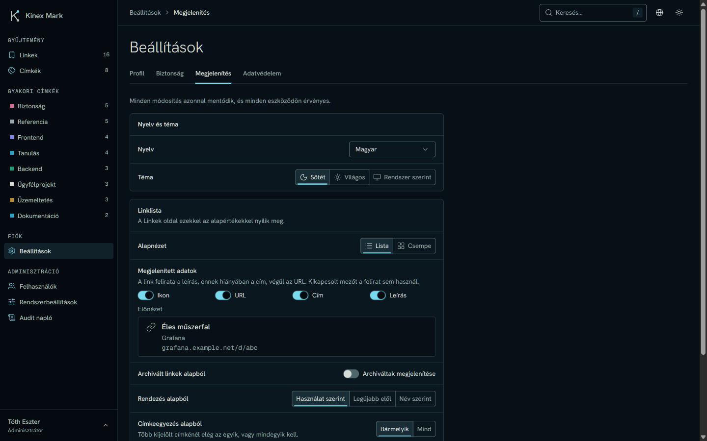

„Minden módosítás azonnal mentődik, és minden eszközödön érvényes.”

- **„Nyelv és téma”:** „Nyelv” (Magyar, English, Deutsch), „Téma” („Sötét”, „Világos”, „Rendszer szerint”).
- **„Linklista”:** „A Linkek oldal ezekkel az alapértékekkel nyílik meg.”
  - „Alapnézet”: „Lista” vagy „Csempe”;
  - „Megjelenített adatok”: „Ikon”, „URL”, „Cím”, „Leírás”, az „Előnézet” rögtön mutatja a hatást;
  - „Archivált linkek alapból”: „Archiváltak megjelenítése”;
  - „Rendezés alapból”: „Használat szerint”, „Legújabb elöl”, „Név szerint”;
  - „Címkeegyezés alapból”: „Bármelyik” vagy „Mind”.
- **„Automatikus archiválás”:** a saját archiválási időd (6.5).

---

## 10. Adatvédelem

### 10.1 Az adatkezelési tájékoztató

A tájékoztatót bárki elolvashatja a bejelentkező oldal „Adatkezelési tájékoztató” linkjével, bejelentkezve a felhasználói menüből vagy a Beállítások › Adatvédelem fülről („Tájékoztató megnyitása”). Szakaszai:

- „Adatkezelő”: az üzemeltető neve, címe, e-mail-címe és adatvédelmi kapcsolattartója;
- „Kezelt adatok”: felhasználónév, megjelenített név, jelszó-hash, titkosított kétlépcsős titok, munkamenetek IP-címmel és böngészőazonosítóval, linkek, címkék, megosztások, használati statisztika, beállítások, biztonsági napló IP-címmel. E-mail-címet, telefonszámot és követési adatot a rendszer nem kezel;
- „Célok” és „Jogalapok”: a szolgáltatás nyújtása (GDPR 6. cikk (1) bekezdés b) pont), illetve a rendszer biztonsága mint jogos érdek (6. cikk (1) bekezdés f) pont);
- „Címzettek”: akikkel linket osztasz meg, látják a linket és a nevedet; a fejlesztők és az adminisztrátorok megosztáskor minden aktív felhasználót megtalálnak felhasználónév, név és szerepkör szerint; az adminisztrátorok a felhasználókezeléshez szükséges adatokat és a biztonsági naplót látják; az üzemeltető tárhelyszolgáltatója adatfeldolgozó;
- „Továbbítás harmadik országba”, „Automatizált döntéshozatal”: egyik sincs;
- „Megőrzési idő”: a munkamenetek és a biztonsági napló megőrzése a rendszerbeállítások szerint, minden más a fiók törléséig;
- „Sütik és helyi tárolás”: egyetlen, a bejelentkezéshez szükséges süti, a téma és a nyelv a böngésző helyi tárolójában; követés és analitika nincs;
- „Metaadat-letöltés”, „Rendszergazdai hozzáférés”;
- „Jogaid”: hozzáférés, adathordozhatóság, helyesbítés, törlés, az adatkezelés korlátozása, tiltakozás, és panasz a felügyeleti hatóságnál.

A korlátozást és a tiltakozást az adatkezelőnél kérheted, a tájékoztatóban szereplő elérhetőségeken.

**Rendszergazdai hozzáférés:** az adminisztrátor visszaállíthatja a jelszavadat, és ezzel beléphet a fiókodba. Bekapcsolt kétlépcsős azonosításnál ehhez a „2FA visszaállítása” is kell, amely szintén a biztonsági naplóba kerül. A jelszó-visszaállítás a biztonsági naplóba kerül, a saját adatexportodban is látod, és a következő belépéskor új jelszót kell megadnod. Más módon az adminisztrátor sem látja a linkjeidet.

### 10.2 Adataid letöltése

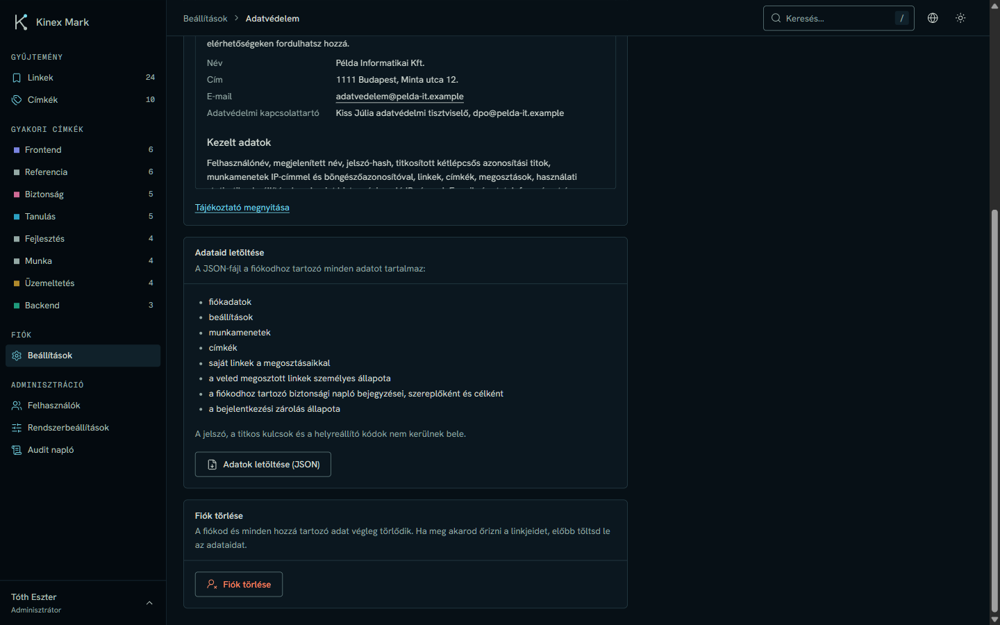

1. Nyisd meg a Beállítások › Adatvédelem fület.
2. Az „Adataid letöltése” kártyán kattints az „Adatok letöltése (JSON)” gombra.

A letöltött `kinex-mark-export-<felhasználónév>-<dátum>.json` fájl tartalma: fiókadatok, beállítások, munkamenetek, címkék, saját linkek a megosztásaikkal, a veled megosztott linkek személyes állapota, a fiókodhoz tartozó biztonsági napló bejegyzései szereplőként és célként, a bejelentkezési zárolás állapota. „A jelszó, a titkos kulcsok és a helyreállító kódok nem kerülnek bele.” A letöltés a biztonsági naplóba kerül.

A linkjeidet böngészőbe importálható formában a Linkek oldal exportjával mentheted (5.10).

A kártya fölött az „Adatkezelési tájékoztató” rész mutatja, melyik verziót és mikor fogadtad el.

### 10.3 Fiók törlése

1. Ha meg akarod őrizni a linkjeidet, előbb töltsd le az adataidat (10.2) vagy exportáld a linkjeidet (5.10).
2. A Beállítások › Adatvédelem fül „Fiók törlése” kártyáján kattints a „Fiók törlése” gombra.
3. A „Törlöd a fiókodat?” dialógusban:
   - ha vannak megosztott linkjeid, figyelmeztetés mutatja, hány tűnik el a címzetteknél is („{n} megosztott linked a címzetteknél is eltűnik.”); szólj a címzetteknek, hogy vegyék fel a saját gyűjteményükbe;
   - töltsd ki a „Jelszó” mezőt;
   - bekapcsolt kétlépcsős azonosításnál töltsd ki a „Hitelesítő vagy helyreállító kód” mezőt;
   - írd be a felhasználónevedet a megerősítő mezőbe („Írd be a felhasználóneved a megerősítéshez: …”).
4. Kattints a „Fiók végleges törlése” gombra.

A fiókod és minden hozzá tartozó adat (linkek, címkék, megosztások, beállítások) végleg törlődik, a biztonsági naplóban a neved álnévre (`deleted-user-<azonosító>`) cserélődik. A törölt adat az adatbázisfájlokban sem marad olvasható. A művelet nem vonható vissza. Az utolsó aktív adminisztrátor nem törölheti a fiókját („Ez az utolsó aktív adminisztrátor.”): előbb nevezz ki egy másikat.

---

## 11. Adminisztráció

Az „Adminisztráció” csoportot csak adminisztrátor látja. Az adminisztrátor sem látja más felhasználók linkjeit, csak a számukat.

Az adminisztrátor által szerkeszthető törzsadatok: a felhasználói fiókok és a szerepkörük (11.1), valamint a rendszerbeállítások: archiválási időszak, munkamenet-időkorlátok, az audit napló megőrzési ideje, a belső hálózati letöltés, az adatkezelő adatai és a tájékoztató verziója (11.2). A három szerepkör (ügyfél, fejlesztő, adminisztrátor) rögzített. A címkék és a színük személyesek: mindenki maga kezeli őket (7. fejezet), közös címkekészlet nincs.

### 11.1 Felhasználók


A lista szűrhető („Keresés”: felhasználónév vagy név; „Szerepkör”; „Állapot”: „Aktív”, „Inaktív”, „Mind”, alapból „Aktív”), oldalanként 50 sorral. Az „Állapot” oszlop „Aktív”, „Inaktív” vagy „Zárolva” értéket mutat, a „2FA” oszlop „Be” értéket, ha a felhasználó bekapcsolta.

**Felhasználó felvétele:**

1. Kattints a „Felhasználó felvétele” gombra.
2. Töltsd ki: „Felhasználónév” (3–64 karakter: betű, szám, pont, kötőjel, aláhúzás; később nem módosítható), „Megjelenített név” (legfeljebb 100 karakter), „Szerepkör”, „Nyelv” (a felület nyelve az első belépéskor).
3. A „Jelszó megadása” résznél válaszd a „Generált jelszó” (ajánlott) vagy a „Megadom” lehetőséget.
4. Kattints a „Felhasználó létrehozása” gombra.
5. Generált jelszónál megjelenik az „Ideiglenes jelszó” dialógus. Másold ki („Jelszó másolása”), és add át biztonságos csatornán. „A jelszó csak most látható”. Kattints a „Kész” gombra.

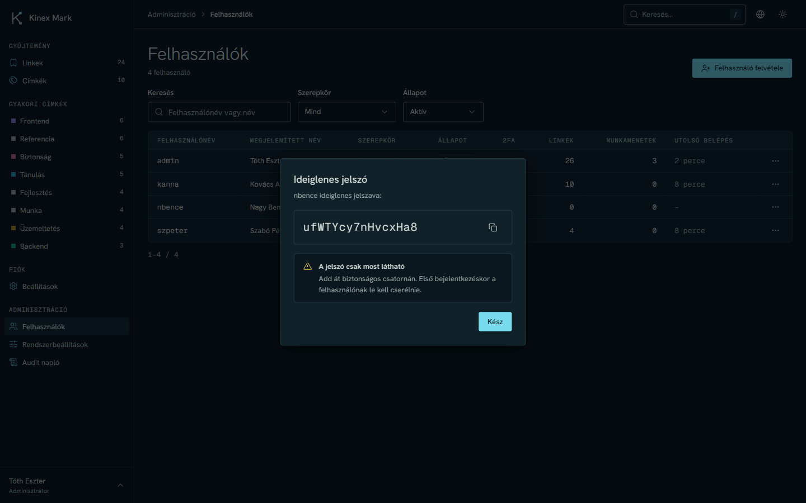

Az új felhasználónak az első belépéskor mindkét esetben saját jelszót kell beállítania (2.3), és nyugtáznia kell a tájékoztatót (2.4).

**Műveletek** (a sor `⋯` menüje, „{felhasználónév} műveletei”):

| Művelet | Mit csinál | Saját jelszó kell |
|---|---|---|
| „Szerkesztés” | megjelenített név, szerepkör, „Aktív” kapcsoló | csak a szerepkör vagy az aktív állapot változásakor |
| „Jelszó visszaállítása” | új, 16 karakteres ideiglenes jelszó; minden munkamenete lezárul, a zárolása feloldódik; a következő belépéskor jelszót kell cserélnie | igen |
| „2FA visszaállítása” (ha be van kapcsolva) | kikapcsolja a kétlépcsős azonosítását, minden munkamenete lezárul | igen |
| „Feloldás” (ha zárolt) | feloldja a bejelentkezési zárolást | nem |
| „Munkamenetek lezárása” | minden eszközén kijelentkezteti | nem |
| „Inaktiválás” / „Aktiválás” | inaktív fiókkal nem lehet belépni, a munkamenetei lezárulnak, az adatai és a megosztásai megmaradnak | igen |
| „Törlés” | a linkjei, címkéi és megosztásai végleg törlődnek, a naplóban a neve álnévre cserélődik | igen |

A megerősítést kérő műveleteknél a dialógusban megjelenik a „Saját jelszavad a megerősítéshez” mező: „A művelet a biztonsági naplóba kerül.” A hibás jelszó ugyanúgy számít a zárolásba, mint a bejelentkezésnél.

Fontos szabályok:

- **A jelszó-visszaállítás az egyetlen út, amelyen adminisztrátor más fiókjába beléphet.** Ezért auditált, a felhasználó a saját adatexportjában is látja, és a következő belépéskor kötelezően jelszót cserél. A visszaállítás a kétlépcsős azonosítást nem kapcsolja ki: bekapcsolt kétlépcsős azonosításnál a belépéshez a „2FA visszaállítása” is kell, amely szintén a biztonsági naplóba kerül.
- A szerepkör-változás azonnal érvényes, a felhasználó munkamenetei megmaradnak. Ha egy fejlesztőt ügyféllé állítasz, a megosztásai szünetelnek (8.3).
- A saját fiókodat itt nem inaktiválhatod, nem törölheted, és a szerepkörödet sem módosíthatod: „A saját fiókodat a Beállítások oldalon kezeled.”
- Az utolsó aktív adminisztrátor nem állítható át más szerepkörre, nem inaktiválható és nem törölhető („Ez az utolsó aktív adminisztrátor.”). Tarts legalább két adminisztrátort.
- Törlés előtt a dialógus megmutatja, hány megosztott linkje tűnik el a címzetteknél.

### 11.2 Rendszerbeállítások


„Minden felhasználóra érvényes beállítások.” A módosítások az oldal alján tapadó sávban menthetők („Beállítások mentése”) vagy dobhatók el („Elvetés”). Mentetlen módosítással az oldal elhagyása előtt a program megerősítést kér.

| Kártya | Mező | Tartomány | Alapérték |
|---|---|---|---|
| „Archiválás” | „Archiválási időszak” | 0–3650 nap (0: soha) | 90 nap |
| „Munkamenetek” | „Tétlenségi idő” | 15–10 080 perc | 720 perc |
| „Munkamenetek” | „Leghosszabb munkamenet” | 1–2160 óra | 168 óra |
| „Audit napló” | „Megőrzési idő” | 30–3650 nap | 180 nap |
| „Metaadat-letöltés” | „Belső hálózati címek engedélyezése” | be / ki | ki |
| „Adatkezelési tájékoztató” | „Adatkezelő neve”, „Adatkezelő címe”, „Adatkezelő e-mail-címe”, „Adatvédelmi kapcsolattartó”, „Illetékes felügyeleti hatóság” | szöveg | üres |

- Az „Archiválási időszak” azokra a felhasználókra érvényes, akik nem állítottak be saját időszakot. Az **„Archiválás futtatása most”** gomb azonnal lefuttatja az automatikus archiválást, az értesítés mutatja az archivált linkek számát.
- A **„Belső hálózati címek engedélyezése”** intranetes linkekhez kell: bekapcsolva a szerver a helyi hálózat címeiről is letöltheti a címet és az ikont. A felhős metaadat-címek és a szerver saját gépe továbbra is tiltottak. Ha az üzemeltető az `APP_ALLOW_PRIVATE_FETCH` környezeti változóval rögzítette, a kapcsoló tiltott: „Környezeti változó rögzíti”. A bekapcsolás előtt tiltott linkekhez a tulajdonos kérjen kézi frissítést (4.5).
- Az **„Adatkezelési tájékoztató”** kártya adatai a tájékoztatóban jelennek meg. A felügyeleti hatóság mezőbe például ezt írd: „Nemzeti Adatvédelmi és Információszabadság Hatóság, naih.hu”; üresen a tájékoztató „a lakóhelyed szerinti adatvédelmi hatóság” szöveget mutatja.
- **„Új verzió kiadása”:** lényeges változásnál (az adatkezelő adatai, a program új verziójának tájékoztató-szövege) adj ki új verziót. A „Kiadod a tájékoztató új verzióját?” kérdés megerősítése után minden felhasználónak újra nyugtáznia kell a következő bejelentkezéskor vagy kéréskor (2.4). Az adatok módosítása magától nem ad ki új verziót.

### 11.3 Audit napló


Az audit napló a biztonsági eseményeket tartalmazza: bejelentkezés, kijelentkezés, zárolás, jelszócsere, kétlépcsős azonosítás, munkamenetek, felhasználókezelés, rendszerbeállítások, tájékoztató-verziók és -elfogadások, adatexport, megosztások. A linkek létrehozása, módosítása és megnyitása nem kerül bele, és a napló soha nem tartalmaz jelszót, kódot, URL-t vagy linkcímet.

Szűrés:

1. „Esemény”: „Mind”, eseménycsoport („Bejelentkezés”, „Munkamenetek”, „Felhasználók”, „Beállítások”, „Adatvédelem”, „Megosztás”) vagy egy konkrét esemény.
2. „Eredmény”: „Sikeres” vagy „Sikertelen”.
3. „Szereplő”: a felhasználó, aki a műveletet végezte.
4. „Ettől”, „Eddig”: napok a helyi idő szerint.
5. „Szűrők törlése”: minden szűrő alaphelyzetbe.

Oszlopok: „Időpont”, „Esemény” (alatta a kód), „Eredmény”, „Szereplő”, „Cél”, „IP”, „Részletek”. A részletek ikon („Részletek megjelenítése”) például a sikertelen belépés okát („Hibás jelszó”, „Ismeretlen felhasználónév”, „Inaktív fiók”, „Hibás kód”) vagy a belépés módját mutatja. A szerveren futtatott helyreállító parancsok bejegyzésének forrása „Parancssor”, szereplője üres. Ismeretlen felhasználónévvel próbálkozó belépésnél a beírt név nem kerül a naplóba. A törölt felhasználók neve `deleted-user-<azonosító>` alakban látszik.

A bejegyzések a „Megőrzési idő” után (alapból 180 nap) törlődnek.

---

## 12. Hibaelhárítás és gyakori kérdések

### 12.1 Zárolták a fiókomat

„Túl sok sikertelen próbálkozás.” Várd meg a megadott percet, vagy kérd meg az adminisztrátort, hogy a Felhasználók oldalon a „Feloldás” művelettel oldja fel (11.1). A zárolás a felhasználónévhez tartozik, így más is zárolhatja a fiókodat, ha ismeri a felhasználónevedet. Ha ez ismétlődik, szólj az adminisztrátornak, az audit napló „Bejelentkezés zárolva” eseményei megmutatják az IP-címet.

**Ha az egyetlen adminisztrátor zárolt vagy elfelejtette a jelszavát**, az üzemeltető a szerveren oldja meg (B.7):

- zárolás feloldása: `kinex-mark -data <adatkönyvtár> -unlock-user <felhasználónév>`;
- új jelszó: `kinex-mark -data <adatkönyvtár> -reset-password <felhasználónév>`.

### 12.2 Elfelejtettem a jelszavamat

Kérd meg egy adminisztrátort, hogy állítsa vissza („Jelszó visszaállítása”, 11.1). Az ideiglenes jelszóval belépve új jelszót kell megadnod. Adminisztrátor esetén lásd 12.1.

### 12.3 Elveszett a hitelesítő eszközöm

1. Lépj be egy helyreállító kóddal („Helyreállító kódot használok”, 2.2).
2. A Beállítások › Biztonság fülön kapcsold ki a kétlépcsős azonosítást egy másik helyreállító kóddal, majd kapcsold be újra az új eszközzel. Ez új helyreállító kódokat is ad.

Ha nincs több helyreállító kódod, egy adminisztrátor a „2FA visszaállítása” művelettel kikapcsolja (11.1), utána kapcsold be újra. A szerveren futtatható `-reset-password` parancs a kétlépcsős azonosítást nem kapcsolja ki, ezért egyetlen adminisztrátor esetén ő a helyreállító kódjaira van utalva.

### 12.4 Nem jelenik meg az ikon vagy a cím

Nézd meg a link részletei lapon a „Metaadat” szakaszt:

| Állapot / hiba | Jelentése | Teendő |
|---|---|---|
| „Letöltés folyamatban” | a letöltés tart vagy újrapróbálásra vár | várj; az újrapróbálás 1, majd 10 perc múlva jön |
| „Időtúllépés”, „Kapcsolódási hiba”, „A domain nem található” | a webhely nem volt elérhető | ellenőrizd az URL-t; „Cím és ikon frissítése” |
| „A webhely hibát adott vissza” | a webhely hibakóddal válaszolt (például 403, 404) | nyisd meg a linket; ha működik, a webhely tiltja az automatikus letöltést, írj kézi címet |
| „Tanúsítványhiba” | a webhely HTTPS-tanúsítványa érvénytelen | írj kézi címet |
| „Nem weboldal (nincs cím)” | a link fájlra (például PDF-re) mutat | írj kézi címet vagy leírást |
| „Belső hálózati cím, a letöltés tiltott” vagy „Tiltott port” | a cím helyi hálózatra mutat, vagy nem engedélyezett portra (csak 80, 443 és 1024–65 535) | lásd 12.5 |
| „Az oldal túl nagy”, „Túl sok átirányítás” | az oldal 1 MB-nál nagyobb, vagy ötnél több átirányítás után sem ért célba | írj kézi címet |

Ha a cím megvan, de az ikon nem: a webhelynek nincs használható ikonja (legfeljebb 64 KB PNG, GIF, JPEG, WebP, ICO vagy szigorú ellenőrzésen átmenő SVG). Ilyenkor általános link ikon látszik.

### 12.5 Belső hálózati (intranetes) linkek

A szerver biztonsági okból alapból nem tölt le címet és ikont a helyi hálózat címeiről (például `10.x.x.x`, `192.168.x.x`). A link ettől mentődik és működik, csak a címe és az ikonja hiányzik. Ha a szervezetednek intranetes linkekre is kell a letöltés, egy adminisztrátor kapcsolja be a „Belső hálózati címek engedélyezése” beállítást (11.2), utána kérj kézi frissítést (4.5). A szerver saját gépének címei (`127.0.0.1`, `localhost`) és a felhős metaadat-címek ilyenkor is tiltottak.

### 12.6 „A kérés nem a Kinex Mark beállított címére érkezett.”

Az alkalmazást más címen nyitottad meg, mint amelyre az üzemeltető beállította (például IP-címmel a domainnév helyett). Nyisd meg a megszokott címén. Üzemeltetőknek: az `APP_BASE_URL` hostja egyezzen azzal, amit a felhasználók a böngészőbe írnak; ha a szerver loopback címen figyel `APP_BASE_URL` nélkül, csak `localhost`, `127.0.0.1` és `[::1]` fogadható el (B.4, B.5).

### 12.7 „A biztonsági ellenőrzés elutasította a kérést.”

Frissítsd az oldalt. Ha minden mentésnél ismétlődik, és az alkalmazás reverse proxy mögött fut, az üzemeltető állítsa be az `APP_BASE_URL` és az `APP_TRUSTED_PROXY` változót (B.5).

### 12.8 A másolás nem működik

A böngésző vágólapja biztonságos kapcsolatot (HTTPS, vagy a saját gépen `localhost`) igényel. Sima HTTP-n a program tartalék módszerrel próbál másolni. Ha az sem sikerül, „A másolás nem sikerült. Jelöld ki és másold kézzel.” üzenet jelenik meg. Ilyenkor nyisd meg a részletek lapot, és jelöld ki az URL-t kézzel. Tartós megoldás a HTTPS-es elérés (B.5).

### 12.9 Eltűnt egy link

- Lehet, hogy archiválódott: kapcsold be az „Archiváltak is” kapcsolót (6.3).
- Lehet, hogy egy szűrő rejti: kattints a „Szűrők törlése” linkre.
- Megosztott linknél lehet, hogy a tulajdonos visszavonta a megosztást, törölte a linket, vagy a szerepköre megváltozott (8.3).

### 12.10 „Közben új tájékoztató jelent meg.” vagy újra a tájékoztató-oldalra kerülök

Egy adminisztrátor új tájékoztató-verziót adott ki. Olvasd el, és nyugtázd (2.4).

### 12.11 Az importálás nem sikerül

- „A fájl nagyobb 2 MB-nál.”: bontsd több fájlra.
- „A fájlban 5000-nél több bejegyzés van.”: bontsd több fájlra, és importáld őket egymás után.
- „A fájl nem értelmezhető.”: Kinex Mark JSON-exportot vagy a böngésző könyvjelző-exportjával készült HTML-fájlt válassz.
- „Elérted a 10 000 linkes korlátot.”: az import egyetlen linket sem hozott létre; törölj régi linkeket, vagy importálj kevesebbet.

---

## A függelék: szerepkörök és jogosultságok

| Művelet | Ügyfél | Fejlesztő | Adminisztrátor |
|---|---|---|---|
| Saját linkek rögzítése, szerkesztése, törlése, importálása, exportálása | igen | igen | igen |
| Saját címkék kezelése (a megosztott linkeken is) | igen | igen | igen |
| A vele megosztott linkek megtekintése, megnyitása, másolása, kitűzése, archiválása | igen | igen | igen |
| Saját link megosztása mindenkivel, szerepkörrel vagy felhasználóval | nem | igen | igen |
| Felhasználók keresése megosztáskor (felhasználónév, név, szerepkör) | nem | igen | igen |
| Saját profil, jelszó, kétlépcsős azonosítás, munkamenetek, megjelenítés | igen | igen | igen |
| Saját adatok letöltése, fiók törlése | igen | igen | igen (az utolsó aktív adminisztrátor nem törölheti magát) |
| Más felhasználó linkjeinek megtekintése (megosztás nélkül) | nem | nem | nem |
| Felhasználók felvétele, szerkesztése, szerepkör és állapot, törlés | nem | nem | igen |
| Jelszó- és 2FA-visszaállítás, feloldás, munkamenetek lezárása | nem | nem | igen |
| Rendszerbeállítások, tájékoztató-verzió kiadása, archiválás azonnali futtatása | nem | nem | igen |
| Audit napló | nem | nem | igen |

A jogosultság határa a szerver: minden kérésnél a fiók aktuális szerepköre dönt, ezért egy szerepkör-változás azonnal érvényes. Más felhasználó linkjére vonatkozó kérésre a szerver úgy válaszol, mintha a link nem létezne.

---

## B függelék: üzemeltetés

Ez a függelék az üzemeltetőnek szól. A rövid futtatási összefoglaló a tárház gyökerében lévő `README.md` fájlban van.

### B.1 Felépítés

- Egyetlen futtatható állomány: a Go-szerver kiszolgálja a beágyazott webes felületet és a JSON API-t. Külső adatbázis, cache vagy üzenetsor nincs.
- Az adatok egy adatkönyvtárban vannak: `app.db` (SQLite, mellette WAL-módban `app.db-wal` és `app.db-shm`) és `secret.key` (szerverkulcs).
- Háttérfeladatok a szerveren belül: archiválás és takarítás induláskor, majd óránként; a cím- és ikonletöltés folyamatosan.
- Naplózás a szabványos kimenetre, szöveges vagy JSON formában.
- A program sima HTTP-n vagy saját TLS-sel fut. Hálózatról TLS-t adó reverse proxy mögött tedd elérhetővé (B.5).

### B.2 Telepítés Docker Compose-zal

A tárház `compose.yaml` fájlja a forrásból építi az image-et, csak a gép loopback címén (`127.0.0.1:8080`) publikálja, csak olvasható konténerben, minden Linux-képesség nélkül, `kinex-mark-data` kötettel a `/data` könyvtárhoz. Az image distroless, nem root felhasználóként (uid 65532) fut, és beépített állapotellenőrzése van.

1. Indítsd el a tárház gyökeréből:

   ```sh
   docker compose up -d --build
   docker compose ps          # STATUS: healthy
   ```

2. Keresd meg a naplóban az első adminisztrátor generált jelszavát:

   ```sh
   docker compose logs kinex-mark | grep "initial admin password generated"
   ```

   PowerShellben:

   ```powershell
   docker compose logs kinex-mark | Select-String "initial admin password generated"
   ```

3. Nyisd meg a `http://127.0.0.1:8080` címet, és lépj be `admin` néven a naplóban talált jelszóval. A program jelszócserét kér (2.3).

A CI által közzétett image-et is használhatod: a `compose.yaml` `image:` sorát cseréld `ghcr.io/kaszasg/kinex-mark:latest`-re (vagy egy verziócímkére), töröld a `build:` részt, és indítsd `docker compose up -d` paranccsal.

Az első adminisztrátor jelszavát előre is megadhatod: írd az `APP_ADMIN_PASSWORD=…` sort a `compose.yaml` mellé egy verziókövetésen kívüli `.env` fájlba, és vedd ki a megjegyzésjelet a `compose.yaml` `APP_ADMIN_PASSWORD: ${APP_ADMIN_PASSWORD}` soráról. Az első indulás után töröld mindkét helyről, különben a `docker inspect` kimenetében marad. A program minden induláskor figyelmeztet, amíg be van állítva.

### B.3 Telepítés futtatható állománnyal

Előállítás a forrásból (kell hozzá Go 1.26 vagy újabb, Node 24 vagy 26+ és npm):

```powershell
.\build.ps1                      # Windows: dist\kinex-mark.exe
.\build.ps1 cross -Version 1.0.0 # linux/amd64, linux/arm64, windows/amd64, darwin/arm64
```

```sh
make build                       # Linux, macOS: dist/kinex-mark
make cross VERSION=1.0.0
```

Futtatás:

```sh
./dist/kinex-mark -addr 127.0.0.1:8080 -data /var/lib/kinex-mark
```

```powershell
.\dist\kinex-mark.exe -addr 127.0.0.1:8080 -data D:\kinex-mark-data
```

- Az alapértelmezett figyelési cím `:8080`, ez minden hálózati csatolón figyel. Reverse proxy mögött adj meg loopback címet.
- Az alapértelmezett adatkönyvtár a munkakönyvtárhoz képest `./data`. A program létrehozza (jogosultság 0750, a kulcsfájlé 0600; Windowson az NTFS-jogosultság dönt).
- Leállítás: `Ctrl+C` vagy SIGTERM. A program legfeljebb 10 másodpercig megvárja a futó kéréseket.
- Állapot: `GET /healthz` → `{"status":"ok"}`; a `kinex-mark -healthcheck` a futó szervert kérdezi le (ugyanazzal az `-addr`, `-tls-cert` és `-tls-key` beállítással futtasd, mint a szervert, kapcsolóval vagy környezeti változóval), és 0 vagy 1 kilépési kóddal tér vissza.
- Verzió: `kinex-mark -version`; a bejelentkező oldal alján is látszik.

Linuxon célszerű saját felhasználóval, rendszerszolgáltatásként futtatni (például systemd egységgel), az adatkönyvtárat csak ennek a felhasználónak írhatóvá téve.

### B.4 Konfiguráció

A beállítások kapcsolóval vagy környezeti változóval adhatók meg. Az elsőbbség: kapcsoló, környezeti változó, alapérték. Az üres környezeti változó nem beállítottnak számít. Hibás érték esetén a program nem indul, a naplóban `invalid configuration` sor és az ok áll (például `config: APP_FETCH_WORKERS: must be between 1 and 16`), a kilépési kód 2.

| Kapcsoló | Környezeti változó | Alapérték | Jelentés |
|---|---|---|---|
| `-addr` | `APP_ADDR` | `:8080` | figyelési cím, `host:port` vagy `:port` |
| `-data` | `APP_DATA_DIR` | `./data` | adatkönyvtár (`app.db`, `secret.key`); a Docker image-ben `/data` |
| `-base-url` | `APP_BASE_URL` | üres | a felület nyilvános címe, például `https://mark.example.com`; `http` vagy `https`, útvonal, query és fragment nélkül. **Reverse proxy mögött kötelező.** Megadva a szerver csak erre a hostra érkező API-kérést fogad el |
| `-secure-cookies` | `APP_SECURE_COOKIES` | `auto` | `auto`, `true` vagy `false`; `auto` esetén a süti `Secure` (és `__Host-` előtagú, HSTS-sel), ha a szerver maga TLS-sel fut, az `APP_BASE_URL` `https`, vagy a megbízható proxy `X-Forwarded-Proto: https` fejlécet küld |
| `-trusted-proxy` | `APP_TRUSTED_PROXY` | üres | vesszővel tagolt IP-címek vagy CIDR-tartományok; csak ezektől fogadja el a szerver az `X-Forwarded-For`, `X-Forwarded-Proto` és `X-Forwarded-Host` fejlécet. **Reverse proxy mögött kötelező**, lehetőleg a proxy egyetlen címével |
| `-allow-private-fetch` | `APP_ALLOW_PRIVATE_FETCH` | üres | `true` vagy `false`; megadva felülírja és zárolja a „Belső hálózati címek engedélyezése” rendszerbeállítást |
| `-allow-loopback-fetch` | `APP_ALLOW_LOOPBACK_FETCH` | `false` | `true` esetén a letöltő a loopback és a link-local címeket is eléri; csak tesztkörnyezetbe |
| `-tls-cert` | `APP_TLS_CERT` | üres | PEM-tanúsítvány; csak a `-tls-key`-jel együtt |
| `-tls-key` | `APP_TLS_KEY` | üres | PEM-kulcs; csak a `-tls-cert`-tel együtt |
| `-log-level` | `APP_LOG_LEVEL` | `info` | `debug`, `info`, `warn`, `error` |
| `-log-format` | `APP_LOG_FORMAT` | `text` | `text` vagy `json` (a `compose.yaml`-ban `json`) |
| `-fetch-workers` | `APP_FETCH_WORKERS` | `2` | párhuzamos letöltők száma, 1–16 |
| `-fetch-timeout` | `APP_FETCH_TIMEOUT` | `10s` | egy letöltés időkorlátja, Go-időtartam `1s` és `60s` között |
| `-admin-user` | `APP_ADMIN_USER` | `admin` | az első adminisztrátor felhasználóneve (csak üres adatbázisnál) |
| – | `APP_ADMIN_PASSWORD` | üres | az első adminisztrátor jelszava (csak üres adatbázisnál); kapcsoló szándékosan nincs, hogy ne látsszon a folyamatlistában |
| – | `APP_SECRET_KEY` | üres | 32 bájtos szerverkulcs base64-ben; elsőbbséget élvez a kulcsfájllal szemben |
| `-secret-key-file` | `APP_SECRET_KEY_FILE` | `<adatkönyvtár>/secret.key` | a szerverkulcs fájlja; ha nincs, a program létrehozza |
| `-healthcheck` | – | – | a futó szerver `/healthz` végpontját kérdezi le, majd kilép |
| `-version` | – | – | kiírja a verziót, majd kilép |
| `-unlock-user <név>` | – | – | offline helyreállítás (B.7) |
| `-reset-password <név>` | – | – | offline helyreállítás (B.7) |

A munkamenetek, az archiválás és az audit-megőrzés idejét nem környezeti változó, hanem a Rendszerbeállítások oldal állítja (11.2).

### B.5 Reverse proxy és TLS

Hálózatról a Kinex Markot TLS-t adó reverse proxy mögött tedd elérhetővé. Ilyenkor **mindkét** változó kötelező:

- `APP_BASE_URL=https://mark.example.com` (a böngészőbe írt nyilvános cím);
- `APP_TRUSTED_PROXY=<a proxy címe>` (ajánlott egyetlen cím; CIDR-tartomány is megadható, de a tartomány bármely gépe hamis kliens-IP-címet küldhet).

Ha hiányoznak: a módosító kérések „A biztonsági ellenőrzés elutasította a kérést.” hibát adnak, a süti nem `Secure`, nincs Host-ellenőrzés, és minden felhasználó a proxy IP-címén osztozik, így 30 hibás belépés bárkitől mindenkit 15 percre kizár. Ha nem megbízott forrásból érkezik `X-Forwarded-*` fejléc, a szerver egyszer figyelmeztet: `request has X-Forwarded-* headers from an untrusted peer; set APP_TRUSTED_PROXY and APP_BASE_URL`. A sor `peer` mezője a proxy címe, ahogy a szerver látja: ezt írd az `APP_TRUSTED_PROXY`-ba.

A proxy adja tovább a `Host` fejlécet változatlanul, és küldje az `X-Forwarded-For`, `X-Forwarded-Proto` és `X-Forwarded-Host` fejlécet. Az importhoz a kéréstörzs legalább 2 MB lehessen.

Caddy (ugyanazon a gépen, a szerver `127.0.0.1:8080`-on, `APP_TRUSTED_PROXY=127.0.0.1`):

```
mark.example.com {
	reverse_proxy 127.0.0.1:8080
}
```

nginx (ugyanígy; az nginx alapértelmezett 1 MB-os törzskorlátja kevés az importhoz):

```nginx
server {
    listen 443 ssl;
    server_name mark.example.com;
    ssl_certificate     /etc/ssl/mark.example.com.crt;
    ssl_certificate_key /etc/ssl/mark.example.com.key;
    client_max_body_size 3m;

    location / {
        proxy_pass http://127.0.0.1:8080;
        proxy_set_header Host $host;
        proxy_set_header X-Forwarded-For $proxy_add_x_forwarded_for;
        proxy_set_header X-Forwarded-Proto $scheme;
        proxy_set_header X-Forwarded-Host $host;
    }
}
```

Docker Compose esetén a proxykonténert és a Kinex Markot tedd egy dedikált hálózatba. A `compose.yaml` megjegyzésben hozza a mintát: `proxy` hálózat `172.30.0.0/29` alhálózattal, a proxy címe `172.30.0.2`, és `APP_TRUSTED_PROXY: 172.30.0.2/32`. A proxykonténer címét rögzítsd a saját szolgáltatásánál: `networks: { proxy: { ipv4_address: 172.30.0.2 } }`, különben a Docker más címet adhat neki. Indítás után ellenőrizd a naplóban, hogy nem jelenik meg a `request has X-Forwarded-* headers from an untrusted peer` figyelmeztetés. Teljes magánhálózati tartományt ne adj meg, mert abból bármely konténer hamis kliens-IP-címet küldhetne.

**Közvetlen TLS proxy nélkül:** add meg a `-tls-cert` és a `-tls-key` fájlt (PEM). A szerver ekkor csak HTTPS-t szolgál ki, TLS 1.2-től. Az `APP_BASE_URL`-t ilyenkor is ajánlott beállítani.

**Proxy nélkül, nem loopback címen** (például konténerben `:8080`) `APP_BASE_URL` nélkül nincs Host-ellenőrzés, ami a belső hálózatból DNS-rebinding támadást tesz lehetővé. Ilyenkor is állítsd be az `APP_BASE_URL`-t.

Az `APP_SECURE_COOKIES=true` értéket ne használd, ha a felhasználók sima HTTP-n érik el a szervert: a böngésző eldobja a `Secure` sütit, és a bejelentkezés nem marad meg.

### B.6 Az első adminisztrátor

Üres adatbázisnál az első induláskor a program létrehoz egy adminisztrátort `APP_ADMIN_USER` néven (alapból `admin`):

- ha az `APP_ADMIN_PASSWORD` meg van adva, ez lesz a jelszava. A jelszónak meg kell felelnie a jelszószabálynak (2.3), különben a program nem indul: `bootstrap admin: password does not meet the policy`. Ilyenkor jelszócsere nem kell. Az első indulás után töröld a változót;
- ha nincs megadva, a program 20 karakteres jelszót generál, és egyetlen egyszer kiírja a naplóba: `initial admin password generated` (`username` és `password` mezővel). Az első belépéskor jelszót kell cserélni.

Ez az egyetlen jelszó, amely valaha a naplóba kerül. Belépés után kapcsold be a kétlépcsős azonosítást (9.3), töltsd ki az adatkezelő adatait (11.2), és vegyél fel egy második adminisztrátort.

### B.7 Offline helyreállító parancsok

Arra az esetre, ha az egyetlen adminisztrátor zárolt vagy elfelejtette a jelszavát. A parancsok HTTP-szervert nem indítanak, a műveletet a biztonsági naplóba írják (forrás: „Parancssor”), majd kilépnek. Ugyanazzal az adatkönyvtárral és szerverkulccsal futtasd őket, mint a szervert. Ajánlott a szerver leállítása mellett futtatni, de futó szerver mellett is biztonságosak.

```sh
kinex-mark -data /var/lib/kinex-mark -unlock-user admin
# Sign-in lock cleared for user admin.

kinex-mark -data /var/lib/kinex-mark -reset-password admin
# New password for user admin: <20 karakteres jelszó>
# The password must be changed at the next sign-in.
```

- `-unlock-user`: törli a felhasználó bejelentkezési zárolását.
- `-reset-password`: új, 20 karakteres jelszót generál, és csak a képernyőre írja ki (a naplóba nem); törli a felhasználó munkameneteit és zárolását; a következő belépéskor jelszót kell cserélni. **A kétlépcsős azonosítást nem kapcsolja ki.**
- Ismeretlen felhasználónál a kilépési kód 1, a naplóban `admin command failed … user not found`. A két parancs nem kombinálható.

Docker Compose-zal:

```sh
docker compose stop
docker compose run --rm kinex-mark -reset-password admin
docker compose start
```

### B.8 Mentés és visszaállítás

Mentsd az **egész adatkönyvtárat**: `app.db`, `app.db-wal`, `app.db-shm` és `secret.key`. Ha a szerverkulcsot `APP_SECRET_KEY`-ben adod meg, azt külön, biztonságos helyen őrizd.

**A `secret.key` nélkül a mentés nem teljes.** A kétlépcsős titkok és a helyreállító kódok ezzel a kulccsal védettek. Ha a kulcs nem illik az adatbázishoz, a program nem indul: `secret key does not match this database: restore the original key file or APP_SECRET_KEY`. Ilyenkor az eredeti kulcsot kell visszaállítani.

Futó szerver mellett ne fájlmásolással ments. Állítsd le a szervert, vagy használd az SQLite saját mentését (`sqlite3 app.db ".backup mentes.db"`, illetve `VACUUM INTO`), és mellé másold a `secret.key`-t.

Docker Compose (a kötet neve a projektkönyvtár nevéből képződik, a tárház alapértelmezett könyvtárneve mellett `kinex-mark_kinex-mark-data`; ellenőrizd a `docker volume ls` paranccsal):

```sh
docker compose stop kinex-mark
docker run --rm -v kinex-mark_kinex-mark-data:/data -v "$PWD":/backup alpine \
  tar czf /backup/kinex-mark-data.tgz -C /data .
docker compose start kinex-mark
```

```powershell
docker compose stop kinex-mark
docker run --rm -v kinex-mark_kinex-mark-data:/data -v "${PWD}:/backup" alpine `
  tar czf /backup/kinex-mark-data.tgz -C /data .
docker compose start kinex-mark
```

Visszaállítás:

```sh
docker compose stop kinex-mark
docker run --rm -v kinex-mark_kinex-mark-data:/data -v "$PWD":/backup alpine \
  sh -c "rm -rf /data/* && tar xzf /backup/kinex-mark-data.tgz -C /data && chown -R 65532:65532 /data"
docker compose start kinex-mark
```

Futtatható állománynál: állítsd le a szervert, cseréld az adatkönyvtár tartalmát a mentésre (a `secret.key`-jel együtt), és indítsd el.

A törölt fiókok adatai a törlés után az adatbázisfájlokban sem maradnak olvashatók, a későbbi mentésekben sincsenek benne. A korábbi mentésekben viszont megvannak: a mentések megőrzési idejét ennek megfelelően állítsd be.

### B.9 Frissítés

1. Készíts mentést (B.8).
2. Cseréld a programot:
   - Docker Compose forrásból: frissítsd a tárházat, majd `docker compose up -d --build`;
   - közzétett image-dzsel: `docker compose pull`, majd `docker compose up -d`;
   - futtatható állománynál: állítsd le a szervert, cseréld az állományt, indítsd el.
3. Az adatbázis-migrációk induláskor maguktól lefutnak. A program csak előre migrál: régebbi verzióra visszatérni csak a frissítés előtti mentéssel lehet.
4. Ellenőrizd: `docker compose ps` (healthy) vagy `GET /healthz`, és a bejelentkező oldal alján a verziót.
5. **Adatkezelési tájékoztató:** ha az új verzió a tájékoztató szövegét is megváltoztatja, vagy ha korábban egy fejlesztői buildet futtattál, és a felhasználók annak a tájékoztató-szövegét nyugtázták, egy adminisztrátor adja ki az új verziót: Rendszerbeállítások › „Adatkezelési tájékoztató” › „Új verzió kiadása” (11.2). A felhasználók a következő bejelentkezéskor vagy kéréskor nyugtázzák. Friss telepítésnél ez nem kell: az 1. verzió már az aktuális szöveg.

### B.10 Üzemeltetési hibaelhárítás

| Jelenség | Ok és teendő |
|---|---|
| `invalid configuration` a naplóban, kilépési kód 2 | hibás kapcsoló vagy környezeti változó; a sor megnevezi, melyik (B.4) |
| `secret key does not match this database` | a kulcsfájl vagy az `APP_SECRET_KEY` nem ehhez az adatbázishoz tartozik; állítsd vissza az eredetit (B.8) |
| `bootstrap admin: password does not meet the policy` | az `APP_ADMIN_PASSWORD` túl rövid, túl egyszerű vagy tartalmazza a felhasználónevet (2.3) |
| `listen: …` hiba | a port foglalt, vagy a cím nem érhető el; válassz másik `-addr` értéket |
| `APP_ADMIN_PASSWORD is set but ignored on a non-empty database; remove it` | az első indulás után bent maradt a változó; töröld |
| `request has X-Forwarded-* headers from an untrusted peer…` | a proxy címe nincs az `APP_TRUSTED_PROXY`-ban (B.5) |
| Minden mentés „A biztonsági ellenőrzés elutasította a kérést.” | `APP_BASE_URL` hiányzik vagy nem egyezik a nyilvános címmel (B.5) |
| „A kérés nem a Kinex Mark beállított címére érkezett.” | a böngészőbe írt host nem egyezik az `APP_BASE_URL` hostjával, vagy loopback figyelési címnél nem `localhost`, `127.0.0.1`, `[::1]` (12.6) |
| Mindenki egyszerre zárolódik ki | a felhasználók a proxy IP-címén osztoznak; állítsd be az `APP_TRUSTED_PROXY`-t (B.5) |
| Az import 413-as hibát ad a proxytól | a proxy törzskorlátja 2 MB alatt van (nginx: `client_max_body_size 3m;`) |
| Nem jön cím és ikon egyetlen linkhez sem | a szerver nem éri el az internetet (DNS, tűzfal, kimenő proxy); a letöltő a környezeti proxyváltozókat szándékosan nem használja. Részletek `-log-level debug` mellett a `metadata fetch failed` sorokban (link-azonosító, hibakód, host) |
| A konténer `unhealthy` | `docker compose logs kinex-mark`; a `/healthz` adatbázis-ellenőrzést is végez |

---

## C függelék: ismert korlátok

- **Zárolás felhasználónév szerint:** aki ismeri a felhasználónevedet, ismételt hibás próbálkozással zárolhatja a fiókodat (zárolásonként legfeljebb 24 óráig). Az adminisztrátor feloldhatja, az egyetlen adminisztrátort az üzemeltető a szerveren (12.1, B.7).
- **Az offline `-reset-password` a kétlépcsős azonosítást nem kapcsolja ki.** Ha az egyetlen adminisztrátor elveszti a hitelesítő eszközét és a helyreállító kódjait is, a fiókja nem állítható helyre. Tarts legalább két adminisztrátort.
- **Importált linkek:** az archiválási idő az import pillanatától számít, nem a könyvjelző eredeti dátumától. Az export és az import a kitűzést, a használati adatokat és a címkeszínt nem viszi át, az új címkék „Semleges” színnel jönnek létre.
- **Keresés és „Név szerint” rendezés:** ékezettől és kis- és nagybetűtől független (az „arviz” megtalálja az „Árvíz” szót, és az „Árvíz” az a betűs feliratok között áll). A rendezés nem a magyar ábécé szerinti: az ö, ő az o, az ü, ű az u betűvel együtt rendeződik, nem utánuk.
- **SVG-ikonok:** a szerver csak a szigorú szerkezeti ellenőrzésen átmenő SVG-ikont tárolja. A szerkesztőprogramok metaadatait vagy idegen névteret tartalmazó SVG helyett a webhely raszteres ikonja (például `/favicon.ico`) vagy az általános link ikon jelenik meg.
- **Vágólap sima HTTP-n:** a másolás biztonságos kapcsolatot igényel, HTTP-n csak a tartalék módszer működhet (12.8).
- **Mennyiségi korlátok:** felhasználónként 10 000 link és 500 címke, linkenként 20 címke; egy import legfeljebb 2 MB és 5000 bejegyzés; egyszerre legfeljebb 20 ráhúzott link.
- **Nagy listák:** a lista 200 linkenként töltődik tovább görgetéskor, a végén „Minden link betöltve.” felirat jelenik meg.
- **Képernyőolvasó:** az értesítések régiójának neve a felhasznált komponens miatt „Értesítések alt+T”.
- **Mentések:** a törölt fiók adatai a törlés előtti mentésekben megmaradnak (B.8).
